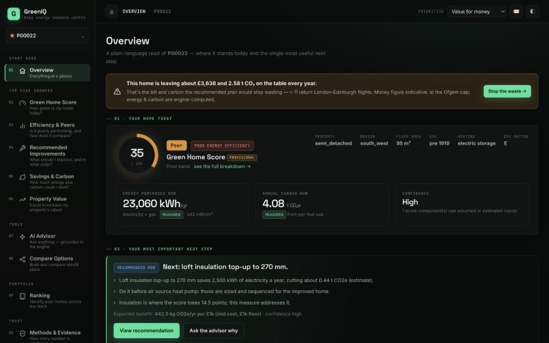

# GreenIQ — Green Home Score & Retrofit Recommendation Engine

[](https://github.com/SHARMA-AtharvaIIIT/Absolut/actions/workflows/ci.yml)


GreenIQ answers a homeowner's four questions — **How green is my home today? What should I
improve? How much energy and carbon could I save? Could it increase my property's value?** —
with numbers from a deterministic engine and explanations you can check line by line.

Built for **Lloyds Megathon Problem Statement 2**. Runs on one port, with no Node build step
and no API key required.



---

## The one law

> **Code computes every number. AI only explains. Every number has a receipt.**

The score, savings, carbon and value figures come from deterministic engines and models
evaluated on held-out data. A language model may only **explain** those computed facts and
answer **what-if** questions *after the engines have re-run*. A [grounding
gate](greeniq/trust/gate.py) blocks any AI sentence containing a number or claim the engines
didn't produce, and shows a deterministic template instead. **A hallucinated number can never
reach the customer** — and the whole app runs with the LLM switched off.

---

## Run it

You need **Python 3.11+** and **[uv](https://docs.astral.sh/uv/)** (`pip install uv` works too).

```bash
git clone https://github.com/SHARMA-AtharvaIIIT/Absolut.git
cd Absolut
uv sync                          # creates .venv with pinned dependencies
uv run python -m greeniq serve   # open http://127.0.0.1:8000
```

The first start analyses all 3,000 homes and caches them (~20 s); later starts take ~3 s.
Explanations come from a built-in template narrator, so everything works with no AI and no key.

**A 3-minute tour** with verified demo homes: [`docs/DEMO_GUIDE.md`](docs/DEMO_GUIDE.md).
Designed for a desktop/laptop screen.

### Optional: add a language model

The LLM layer is isolated in [`greeniq/trust/llm.py`](greeniq/trust/llm.py) and gated, so any
model works — even free local ones.

| Provider | How |
|---|---|
| **None (default)** | Nothing to do. The checked template narrator is used. |
| **Claude** | `uv sync --extra llm`, then `ANTHROPIC_API_KEY=… uv run python -m greeniq serve` |
| **Ollama (local, offline)** | `ollama pull qwen2.5:7b`, then `GREENIQ_LLM_PROVIDER=ollama uv run python -m greeniq serve` |
| **Any OpenAI-compatible endpoint** | set `GREENIQ_LLM_BASE_URL` + `GREENIQ_LLM_API_KEY` + `GREENIQ_LLM_MODEL` (Groq / Gemini / OpenRouter free tiers work) |

Whatever the model writes passes the grounding gate first, or the template is shown instead.
`GREENIQ_LLM=off` forces the template.

---

## What GreenIQ produces

| Customer question | Output | How it's produced |
|---|---|---|
| How green is my home? | **Green Home Score 0–100**, band, per-component contributions | Weighted sum of 7 monotonic sub-scores (PS-fixed weights) |
| What should I improve? | **Prioritised, feasible retrofits** with suitability H/M/L | Feasibility rules → interaction-aware ordering |
| How much could I save? | **Energy per fuel** (electricity & gas separately) + **carbon** | Per-fuel energy engine + `ΔC = Σ ΔE_f × EF_f` with cited factors |
| Is it worth more? | **Indicative value range**, before vs after | Market-relationship model, explicitly non-causal |
| Why? / What if? | **Grounded explanations** and **live what-if** | Recompute → diff → gated narration |

---

## Evidence

Every method is benchmarked against a simple baseline on a **held-out test split** (split by
customer; scored once, after all tuning). Full report:
[`reports/EVALUATION.md`](reports/EVALUATION.md), regenerated from code on each run.

| Output | Metric | GreenIQ | Simple baseline |
|---|---|---|---|
| Retrofit saving, electricity (77 observed retrofits) | MAE kWh | **153** | 699 (flat % rule of thumb) |
| Retrofit saving, gas (77 observed retrofits) | MAE kWh | **272** | 1,600 (flat % rule of thumb) |
| Heat-pump electricity direction | % correct | **100%** | 17% |
| Ranking poor homes | Spearman vs true potential | **0.850** | 0.644 |
| Energy rating when no EPC | MAE SAP points | **4.4** | 7.1 (peer median) |
| Baseline gas (meters insufficient) | MAE kWh | **1,963** | 3,046 (peer median × area) |

Score band agreement with true inputs **93.7%**; score ranges cover the truth **95%** of the
time; feasibility recall **97.5%**. ~3.9 ms per home.

> Where a simple baseline wins, the product *uses it* or labels the output as an estimate —
> the evaluation reports losses as honestly as wins.

---

## How it works

```
HomeState ──► analyse_home() ──► ComputedFacts ──► { API · Decision Lab · grounded narrator }
             (greeniq/pipeline.py)   one contract,
                                     the single source of every number
```

- **Engine** — [`greeniq/pipeline.py`](greeniq/pipeline.py): `analyse_home → ComputedFacts`, the
  single source of every number on screen.
- **Next best action** — [`greeniq/engines/nba.py`](greeniq/engines/nba.py): one action per home
  from computed facts, with traced reasons that respect prerequisites.
- **Decision Lab** — [`greeniq/lab.py`](greeniq/lab.py): cost-vs-carbon frontier, dependency
  graph, energy Sankey, sensitivity.
- **Grounded AI** — [`greeniq/trust/`](greeniq/trust/): `gate.py`, `narrator.py`, `llm.py`,
  `assistant.py`, `prompts.py`.
- **API + web** — [`greeniq/api.py`](greeniq/api.py) (FastAPI) and [`greeniq/web/`](greeniq/web/)
  (a dependency-free single-page app served on the same port).

Architecture in depth: [`docs/ARCHITECTURE.md`](docs/ARCHITECTURE.md).

---

## Reproduce the evidence

```bash
uv run pytest                                   # the full test suite
uv run python -m greeniq analyse P00007         # one home in the terminal
uv run python -m greeniq real-evidence          # real NEED data → reports/REAL_DATA.md (~20 s)
uv run python -m greeniq evaluate               # held-out test split → reports/EVALUATION.md
uv run python -m greeniq eval-grounding         # grounding gate → reports/GROUNDING.md
uv run python -m greeniq edge-sweep             # every PS2 scenario over 3,000 homes (~90 s)
uv run python -m greeniq generate && uv run python -m greeniq train   # rebuild data + models
```

> On a machine with ROS installed, prefix commands with `env -u PYTHONPATH` (ROS pytest plugins leak in).

---

## Data & honesty

The app's detailed homes are **synthetic**, from a documented simulator
([`data/DATA_CARD.md`](data/DATA_CARD.md)). Agreement with the simulated world shows the method
and pipeline work; **it is not a claim of real-world accuracy.**

Real data — **DESNZ NEED (50,000 real homes, OGL v3.0)** — drives the real-home benchmarks, the
real retrofit-saving evidence and the real-data model evaluation
([`reports/REAL_DATA.md`](reports/REAL_DATA.md)). Figures derived from it carry a `real data` badge
in the UI.

---

## Tech stack

Python 3.11 · FastAPI + Uvicorn · scikit-learn · pandas / numpy · pydantic · a dependency-free
vanilla-JS single-page app. No Node build step. Dependencies pinned in
[`pyproject.toml`](pyproject.toml) / [`uv.lock`](uv.lock); tests run in CI on every push.

## Repository layout

| Path | What's there |
|---|---|
| [`greeniq/`](greeniq/) | The engine, API, web app, ML models and the grounded-AI layer |
| [`data/`](data/) | The synthetic dataset and its [data card](data/DATA_CARD.md) |
| [`models/`](models/) | Trained, versioned model artifacts |
| [`reports/`](reports/) | Evaluation, grounding and edge-case reports (regenerated from code) |
| [`tests/`](tests/) | The test suite |
| [`docs/`](docs/) | Architecture, scoring method, LLM design, Responsible AI, demo guide, ADRs |

## Documentation

- [Architecture](docs/ARCHITECTURE.md) — components, the domain contract, trust boundary
- [Scoring method](docs/SCORING_METHOD.md) — the Green Home Score, formula by formula
- [Methodology](docs/METHODOLOGY.md) — energy, carbon, savings and value models
- [LLM design](docs/LLM.md) — the grounded-AI layer and the grounding gate
- [Responsible AI](docs/RESPONSIBLE_AI.md) — failure modes, uncertainty, honest limits
- [Demo guide](docs/DEMO_GUIDE.md) — a verified 3-minute walkthrough
- [Decision records](docs/adr/) — the key design decisions and why

## License

[MIT](LICENSE).
