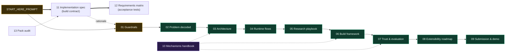

# GreenIQ — Green Home Score & Retrofit Recommendation Engine

> ## 🔄 Live status (updated as work happens)
> **Built and tested:** score, ranking, retrofits, per-fuel savings, carbon, value range, Next Best Action,
> API + dashboard + Decision Lab, grounding gate, what-if assistant, local-LLM support (llama.cpp / Ollama /
> free hosted / Claude). 177 tests pass; 0 violations in a 28,422-check sweep.
> **Now:** real data (DESNZ NEED, 50,000 real homes) is in. R1–R4 are done: real energy model, real retrofit savings
> (loft 5.6%, cavity 11.1% of gas; solar 9.8% of imports), and peer comparison in the product. R6 (LLM pass rate) is running;
> R5, R7 and R8 are next. Results: [`reports/REAL_DATA.md`](reports/REAL_DATA.md).
> **Read this first:** [`docs/STATUS_AND_PLAN.md`](docs/STATUS_AND_PLAN.md) (what's real vs synthetic, what's
> done, what's next, and a prompt to paste into ChatGPT for advice).


**Our solution to Lloyds Problem Statement 2.** GreenIQ answers a homeowner's four
questions: *How green is my home today? What should I improve? How much energy and
carbon could I save? Could it increase my property's value?* It does this with numbers
you can trust and explanations you can check.


## Run it

### 1 · Install (once)
You need **Python 3.11+** and **[uv](https://docs.astral.sh/uv/)** (`pip install uv` works too). No Node, no API key.
```bash
git clone https://github.com/SHARMA-AtharvaIIIT/Absolut.git
cd Absolut
git checkout beautiful        # or main (kept in sync)
uv sync                       # creates .venv with the pinned dependencies
```

### 2 · Start the app
```bash
uv run python -m greeniq serve
```
Open **http://127.0.0.1:8000**. The first start analyses all 3,000 homes and caches them (~20 s); later starts take ~3 s.
Explanations come from the built-in template narrator, so everything works with no AI and no key.

### 3 · What to click (a 3-minute tour)
1. **Dashboard**: portfolio KPIs, score bands, the triage queue (each home's Next Best Action).
2. **Properties** → open a home (e.g. `P00007`):
   - **Score breakdown**: 7 fixed-weight parts with points earned and lost.
   - **Homes like yours** (`real data` badge): this home vs real DESNZ NEED homes of the same type, size and age.
   - **Next Best Action** with three reasons; **recommendations** with per-fuel kWh, costs and real-evidence lines.
   - **Ask a what-if**: e.g. "What if I only add a heat pump?" The engine reruns, and electricity goes **up** while gas goes down.
   - **The grounding gate at work**: click *Show it*. An honest explanation passes; an invented number, a flipped
     direction and a value promise are blocked.
3. **Decision Lab**: named plans (lowest cost / greenest / best value / my budget), cost-vs-carbon frontier,
   dependency graph, energy Sankey, interaction heatmap, sensitivity.
4. **Analytics** and **Evidence**: model results vs baselines, data sources, receipts.
   Toggle **Evidence mode** (sidebar) to see where every sentence and number comes from.

### 4 · Optional: a free local AI narrator (no API key, no cost)
Any OpenAI-compatible local server works. Example with **llama.cpp** (~45 MB) and **Qwen2.5-1.5B** (~1.1 GB):
```bash
# download llama-server (Linux CPU build): https://github.com/ggml-org/llama.cpp/releases (llama-bXXXX-bin-ubuntu-x64.tar.gz)
# download the model: https://huggingface.co/Qwen/Qwen2.5-1.5B-Instruct-GGUF (qwen2.5-1.5b-instruct-q4_k_m.gguf)
./llama-server -m qwen2.5-1.5b-instruct-q4_k_m.gguf --port 8081 --alias qwen2.5-1.5b-instruct
# in another terminal:
GREENIQ_LLM_PROVIDER=openai_compatible GREENIQ_LLM_BASE_URL=http://127.0.0.1:8081/v1 \
  GREENIQ_LLM_MODEL=qwen2.5-1.5b-instruct uv run python -m greeniq serve
```
Other options: **Ollama** (`ollama pull qwen2.5:7b`, then `GREENIQ_LLM_PROVIDER=ollama`); a **free hosted tier**
(Groq, Gemini, OpenRouter) via `GREENIQ_LLM_BASE_URL` + `GREENIQ_LLM_API_KEY` + `GREENIQ_LLM_MODEL`; or **Claude**
(`uv sync --extra llm`, set `ANTHROPIC_API_KEY`). Whatever the model writes passes the grounding gate first, or the
template is shown instead. `GREENIQ_LLM=off` forces the template.

### 5 · Reproduce the evidence
```bash
uv run pytest                                   # all tests
uv run python -m greeniq analyse P00007         # one home in the terminal
uv run python -m greeniq real-evidence          # real NEED data → reports/REAL_DATA.md (~20 s)
uv run python -m greeniq evaluate               # held-out test split → reports/EVALUATION.md
uv run python -m greeniq eval-grounding         # grounding gate → reports/GROUNDING.md (add --llm 20 with a model)
uv run python -m greeniq edge-sweep             # every PS2 scenario over 3,000 homes → reports/EDGE_CASES.md (~90 s)
uv run python -m greeniq generate && uv run python -m greeniq train   # rebuild the synthetic data and models from scratch
```
> On a machine with ROS installed, prefix commands with `env -u PYTHONPATH` (ROS pytest plugins leak in).

**Data:** the app's detailed homes are **synthetic** (documented simulator, [`data/DATA_CARD.md`](data/DATA_CARD.md)).
Real data, **DESNZ NEED (50,000 real homes, OGL v3.0)**, drives the real-home benchmarks, the real retrofit
evidence and the real-data model evaluation ([`reports/REAL_DATA.md`](reports/REAL_DATA.md)). Real figures carry a `real data` badge.

---

## Project state & how to continue (handoff)

**Everything below is on branch `beautiful`; `main` is kept in sync (fast-forward, never force-push).**

| Phase | What it delivers | Status |
|---|---|---|
| P1 Stabilise | verified engine (88 tests), merged `main` in | ✅ |
| P2 Next Best Action | one action per home from computed facts, 3 traced reasons, respects prerequisites | ✅ |
| P3 API + dashboard | one-port no-build web app; portfolio, properties, property view, analytics, evidence | ✅ |
| P4 Decision Lab | Choose Your Plan, cost-vs-carbon frontier, dependency graph, energy Sankey, interaction heatmap, sensitivity | ✅ |
| P5 Grounded AI | grounding gate, gated explain, what-if assistant, groundedness eval, UI, e2e sweep, docs | ✅ |

**Key files** — engine: [`greeniq/pipeline.py`](greeniq/pipeline.py) (`analyse_home` → `ComputedFacts`, the single
source of every number); NBA: [`greeniq/engines/nba.py`](greeniq/engines/nba.py); Decision Lab:
[`greeniq/lab.py`](greeniq/lab.py); API: [`greeniq/api.py`](greeniq/api.py); UI: [`greeniq/web/`](greeniq/web/);
grounded AI: [`greeniq/trust/`](greeniq/trust/) (`gate.py`, `narrator.py`, `llm.py`, `assistant.py`, `prompts.py`).

**Submission artifacts (PS2 §13):** working app (`uv run python -m greeniq serve`) · source + data scripts ·
models in [`models/`](models/) · scoring [`docs/SCORING_METHOD.md`](docs/SCORING_METHOD.md) · LLM
[`docs/LLM.md`](docs/LLM.md) · architecture [`docs/ARCHITECTURE.md`](docs/ARCHITECTURE.md) · evaluation
[`reports/EVALUATION.md`](reports/EVALUATION.md), [`reports/GROUNDING.md`](reports/GROUNDING.md),
[`reports/EDGE_CASES.md`](reports/EDGE_CASES.md) · Responsible AI [`docs/RESPONSIBLE_AI.md`](docs/RESPONSIBLE_AI.md) ·
held-out predictions [`reports/test_predictions.csv`](reports/test_predictions.csv).

### The grounded-AI (LLM) layer — and testing it for free

The PS2 brief requires an LLM that **only explains** computed results and answers what-ifs (it must never
calculate or invent numbers); it is worth 15% of the score (artifact E). Our design keeps that boundary:

- The engine computes every number; the LLM only rewrites a fact sheet into plain English.
- A **grounding gate** ([`greeniq/trust/gate.py`](greeniq/trust/gate.py)) checks every explanation (numbers,
  units, per-fuel direction, causal value wording, scenario identity). **Anything that fails never reaches the
  user — the deterministic template explanation is shown instead.**
- The app runs fully **with the LLM off** (no key needed) on that template narrator.

Because the gate checks the *text*, not the model, **any LLM can be used to exercise the path** — including
free ones. The LLM call is isolated in [`greeniq/trust/llm.py`](greeniq/trust/llm.py):

- **Default:** Claude (`claude-opus-5-5`), used only if `ANTHROPIC_API_KEY` is set and `uv sync --extra llm`
  has installed the `anthropic` package. Each explanation shown is then one API call.
- **Free testing (not wired; optional):** add an OpenAI-compatible branch (uses `httpx`,
  already a dependency — no new package) pointed via env vars at a free endpoint:
  - **Ollama (local, no key, offline):** install Ollama, `ollama pull llama3.1`, point at `http://localhost:11434/v1`.
  - **Groq / Google Gemini / OpenRouter free tiers:** sign up, paste a free key, point at their OpenAI-compatible URL.
  - A weaker free model is a *good* stress test: if its hallucinations get caught and fall back to the template,
    that demonstrates the safety design.
- **`GREENIQ_LLM=off`** forces the template narrator regardless of keys.

Run the groundedness evaluation (ER-4): `uv run python -m greeniq eval-grounding` (add `--llm N` to also run the
model on N homes once a provider is configured) → [`reports/GROUNDING.md`](reports/GROUNDING.md).

> **Prototype implementation:** a working deterministic Python prototype now lives in
> [`greenpath_home/`](greenpath_home/). It uses generated sample data and includes
> scoring, poor-home ranking, retrofit recommendations, energy savings, carbon
> reduction, indicative property-value impact, docs, and tests.

> **How the prototype fits:** its ideas, wording and tests are **helpers and
> suggestions** for the main build. Where the spec or a better idea exists, that wins.
> See [`docs/14_GREENPATH_PROTOTYPE_NOTES.md`](docs/14_GREENPATH_PROTOTYPE_NOTES.md).

---

## The one law

> **Code computes every number. AI only explains. Every number has a receipt.**

The score, savings, carbon and value figures come from deterministic engines and
evaluated models. A language model may only **explain** those computed facts and answer
**what-if** questions **after the engines have rerun**. A **grounding gate** blocks any AI
sentence that contains a number or claim the engines didn't produce, and a deterministic
template takes its place. A hallucinated number can never reach the customer.

## What GreenIQ produces

| Customer question | Output | How it's produced |
|---|---|---|
| How green is my home? | **Green Home Score 0–100**, band, per-component contributions | Weighted sum of 7 monotonic sub-scores (PS-fixed weights) |
| What should I improve? | **Prioritised, feasible retrofits** with suitability H/M/L | Feasibility rules → interaction-aware ordering |
| How much could I save? | **Energy per fuel** (electricity & gas separately) + **carbon** | Per-fuel energy engine + `ΔC = Σ ΔE_f × EF_f` with cited factors |
| Is it worth more? | **Indicative value range**, before vs after | Market-relationship model, explicitly non-causal |
| Why? / What if? | **Grounded explanations** and **live what-if** | Recompute → diff → gated narration |

---

## The pack



| # | Document | What it gives you |
|---|---|---|
| ▶ | [`START_HERE_PROMPT.md`](START_HERE_PROMPT.md) | The prompt that starts the build session |
| 01 | [Guardrails](docs/01_GUARDRAILS.md) | Binding rules: scope, borrowing, the one law, PS-fixed formulas, data and engineering rules |
| 02 | [Problem decoded](docs/02_PROBLEM_DECODED.md) | PS2 → traceable requirement IDs (FR/DR/ER/SR) + judging weights |
| 03 | [Architecture](docs/03_ARCHITECTURE.md) | Layers, components, the domain contract, provider seams, trust boundary |
| 04 | [Runtime flows](docs/04_RUNTIME_FLOWS.md) | Sequence diagrams: analyse, explain, what-if, portfolio, memory; the gate's logic |
| 05 | [Research playbook](docs/05_RESEARCH_PLAYBOOK.md) | Research questions, where to look, the candidate scorecard, the borrow protocol |
| 06 | [Build framework](docs/06_BUILD_FRAMEWORK.md) | Phases + exit gates, walking skeleton, definition of done, testing strategy |
| 07 | [Trust & evaluation](docs/07_TRUST_AND_EVALUATION.md) | Hallucination defence in depth, failure modes, evaluation framework, Responsible AI |
| 08 | [Extensibility roadmap](docs/08_EXTENSIBILITY_ROADMAP.md) | Extension points + advanced feature backlog |
| 09 | [Submission & demo](docs/09_SUBMISSION_AND_DEMO.md) | PS2 deliverables checklist, readiness checks, pitch + demo path |
| 10 | [Mechanisms handbook](docs/10_MECHANISMS_HANDBOOK.md) | 18 proven mechanisms + hard-won lessons, pre-distilled from the team's earlier work |
| **11** | **[Implementation spec](docs/11_IMPLEMENTATION_SPEC.md)** | **The build contract:** stack, layout, data pipeline, every formula and table, LLM interface, API, DB, screens, tests, evaluation, commands |
| 12 | [Requirements matrix](docs/12_REQUIREMENTS_MATRIX.md) | Every mandatory PS2 requirement → module → calculation → acceptance test |
| 13 | [Pack audit](docs/13_PACK_AUDIT.md) | Blocking/important gaps found and fixed; accepted trade-offs |
| 14 | [Prototype notes](docs/14_GREENPATH_PROTOTYPE_NOTES.md) | What to borrow from `greenpath_home/` (helpers) vs what the spec supersedes |
| ADR | [Decision records](docs/adr/) | ADR-001 (deterministic core, grounded language), ADR-002 (base-product decisions), template |
| PS | [Problem statement](docs/reference/LLOYDS-ps2.pdf) | The source of truth |

## How to start the build

1. Open a fresh Claude Code session with access to this repository.
2. Paste everything in the box in [`START_HERE_PROMPT.md`](START_HERE_PROMPT.md).
3. It reads the problem statement and the spec, then builds and integrates the
   **complete base product** (data pipeline, engines, LLM layer, what-if, API, frontend,
   tests, evaluation, submission docs) in one pass, runs and fixes the tests, verifies
   the flows end to end, and pushes. Advanced features come next, behind the seams.

## Principles at a glance

- **Deterministic core, language at the edge.** Numbers are computed; words are gated.
- **One contract.** `HomeState → ComputedFacts`, read and written by every module.
- **Seams with fallbacks.** Every intelligent step has a baseline, and a clean clone
  runs with no keys.
- **Receipts everywhere.** Click any number to see its inputs, method and source.
- **Honest uncertainty.** Estimates are labelled, value is a range, and "insufficient
  information" is a valid answer.
- **Evidence over sophistication.** Every model is benchmarked against a simple baseline
  on held-out data.
