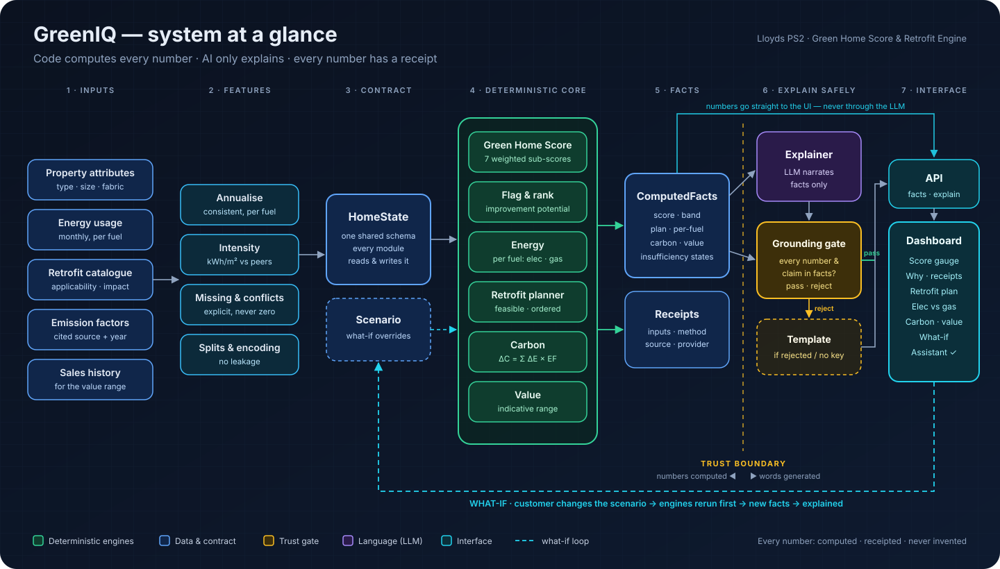

# GreenIQ — Green Home Score & Retrofit Recommendation Engine

**Our solution to Lloyds Problem Statement 2.** GreenIQ answers a homeowner's four
questions: *How green is my home today? What should I improve? How much energy and
carbon could I save? Could it increase my property's value?* It does this with numbers
you can trust and explanations you can check.

> **Status:** architecture & build pack, ready for the build. This repository currently
> holds the **plan, the rules, and the system design**. The application is built on top
> of it by following [`START_HERE_PROMPT.md`](START_HERE_PROMPT.md).

---

## The one law

> **Code computes every number. AI only explains. Every number has a receipt.**

The score, savings, carbon and value figures come from deterministic engines and
evaluated models. A language model may only **explain** those computed facts and answer
**what-if** questions **after the engines have rerun**. A **grounding gate** blocks any AI
sentence that contains a number or claim the engines didn't produce, and a deterministic
template takes its place. A hallucinated number can never reach the customer.

## What GreenIQ produces

| Customer question | Output | How it's produced |
|---|---|---|
| How green is my home? | **Green Home Score 0–100**, band, per-component contributions | Weighted sum of 7 monotonic sub-scores (PS-fixed weights) |
| What should I improve? | **Prioritised, feasible retrofits** with suitability H/M/L | Feasibility rules → interaction-aware ordering |
| How much could I save? | **Energy per fuel** (electricity & gas separately) + **carbon** | Per-fuel energy engine + `ΔC = Σ ΔE_f × EF_f` with cited factors |
| Is it worth more? | **Indicative value range**, before vs after | Market-relationship model, explicitly non-causal |
| Why? / What if? | **Grounded explanations** and **live what-if** | Recompute → diff → gated narration |

---

## The pack

| # | Document | What it gives you |
|---|---|---|
| ▶ | [`START_HERE_PROMPT.md`](START_HERE_PROMPT.md) | The prompt that starts the build session |
| 01 | [Guardrails](docs/01_GUARDRAILS.md) | Binding rules: scope, borrowing, the one law, PS-fixed formulas, data and engineering rules |
| 02 | [Problem decoded](docs/02_PROBLEM_DECODED.md) | PS2 → traceable requirement IDs (FR/DR/ER/SR) + judging weights |
| 03 | [Architecture](docs/03_ARCHITECTURE.md) | Layers, components, the domain contract, provider seams, trust boundary |
| 04 | [Runtime flows](docs/04_RUNTIME_FLOWS.md) | Sequence diagrams: analyse, explain, what-if, portfolio, memory; the gate's logic |
| 05 | [Research playbook](docs/05_RESEARCH_PLAYBOOK.md) | Research questions, where to look, the candidate scorecard, the borrow protocol |
| 06 | [Build framework](docs/06_BUILD_FRAMEWORK.md) | Phases + exit gates, walking skeleton, definition of done, testing strategy |
| 07 | [Trust & evaluation](docs/07_TRUST_AND_EVALUATION.md) | Hallucination defence in depth, failure modes, evaluation framework, Responsible AI |
| 08 | [Extensibility roadmap](docs/08_EXTENSIBILITY_ROADMAP.md) | Extension points + advanced feature backlog |
| 09 | [Submission & demo](docs/09_SUBMISSION_AND_DEMO.md) | PS2 deliverables checklist, readiness checks, pitch + demo path |
| 10 | [Mechanisms handbook](docs/10_MECHANISMS_HANDBOOK.md) | 18 proven mechanisms + hard-won lessons, pre-distilled from the team's earlier work |
| ADR | [Decision records](docs/adr/) | ADR-001 (deterministic core, grounded language) + template |
| PS | [Problem statement](docs/reference/LLOYDS-ps2.pdf) | The source of truth |

## How to start the build

1. Open a fresh Claude Code session with access to this repository.
2. Paste everything in the box in [`START_HERE_PROMPT.md`](START_HERE_PROMPT.md).
3. It reads the pack, researches what's still open, records its decisions as ADRs, and
   builds a clean, extensible starter that meets every PS2 requirement at a transparent
   baseline, with seams ready for the advanced features.

## Principles at a glance

- **Deterministic core, language at the edge.** Numbers are computed; words are gated.
- **One contract.** `HomeState → ComputedFacts`, read and written by every module.
- **Seams with fallbacks.** Every intelligent step has a baseline, and a clean clone
  runs with no keys.
- **Receipts everywhere.** Click any number to see its inputs, method and source.
- **Honest uncertainty.** Estimates are labelled, value is a range, and "insufficient
  information" is a valid answer.
- **Evidence over sophistication.** Every model is benchmarked against a simple baseline
  on held-out data.
