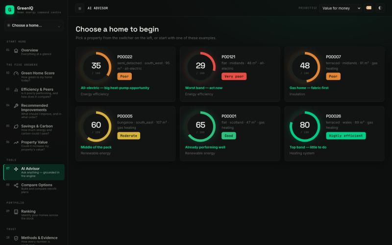
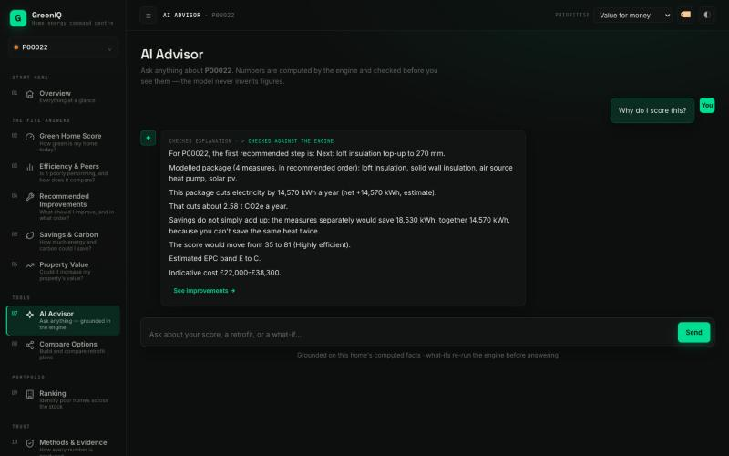

<div align="center">

# GreenIQ

### Green Home Score & Retrofit Recommendation Engine

*A deterministic engine that scores a home's energy efficiency, recommends the retrofits that matter, and estimates the energy, carbon and value impact — with a grounded-AI layer that explains every number but can never invent one.*

[](https://github.com/saix0x0/greeniq/actions/workflows/ci.yml)
[](https://github.com/saix0x0/greeniq/actions/workflows/ci.yml)


[](LICENSE)

</div>


Built for **Lloyds Megathon X — Problem Statement 2**. GreenIQ answers the four questions a
homeowner actually asks — *How green is my home today? What should I improve? How much energy and
carbon could I save? Could it increase my property's value?* — on one port, with no Node build
step and no API key required.

## Contents

- [The one law](#the-one-law)
- [The problem, and how we tackled it](#the-problem-and-how-we-tackled-it)
- [Highlights](#highlights)
- [A look at it](#a-look-at-it)
- [What GreenIQ produces](#what-greeniq-produces)
- [Evidence](#evidence)
- [How it works](#how-it-works)
- [Quickstart](#quickstart)
- [Reproduce the evidence](#reproduce-the-evidence)
- [Data](#data)
- [Tech stack](#tech-stack)
- [Repository layout](#repository-layout)
- [Documentation](#documentation)
- [Contributing & security](#contributing--security)

## The one law

> **Code computes every number. AI only explains. Every number has a receipt.**

The score, savings, carbon and value figures come from deterministic engines and models evaluated
on held-out data. A language model may only **explain** those computed facts and answer
**what-if** questions *after the engines have re-run*. A [grounding gate](greeniq/trust/gate.py)
blocks any AI sentence containing a number or claim the engines didn't produce, and shows a
deterministic template instead. **A hallucinated number can never reach the customer** — and the
whole app runs with the LLM switched off.

## The problem, and how we tackled it

**Problem Statement 2 (Lloyds Megathon X).** Build an AI system that analyses property
characteristics and energy use to compute a **Green Home Score**, flag poor-efficiency homes,
recommend **feasible retrofits**, and estimate **per-fuel savings, carbon reduction and
property-value impact** — under a hard rule that the LLM *explains* results but never computes or
invents them.

We implemented every required output and respected that rule by construction:

| What the brief asked for | How GreenIQ does it |
|---|---|
| A 0–100 score from **seven weighted, monotonic** sub-scores (fixed weights) | Documented, unit-tested sub-score mappings combined with the brief's weights — a better home never scores lower |
| Identify poor homes and **rank by improvement potential** | Ranked by true achievable potential, not raw consumption, so a large house isn't punished for its size |
| **Prioritised, feasible** retrofits | Feasibility rules + interaction-aware ordering (insulate before a heat pump; you can't save the same heat twice) |
| **Per-fuel** savings and carbon | Electricity and gas modelled separately; carbon via `ΔC = Σ_f ΔE_f × EF_f` with cited DESNZ 2025 factors |
| Property-value impact as an **indicative range** | Hedonic regression with a conformal interval, kept explicitly non-causal |
| An LLM that **only explains** | A grounding gate verifies every sentence against the engine; what-ifs re-run the engine first |

The full brief is preserved and mapped line-by-line in
**[`docs/PROBLEM_STATEMENT.md`](docs/PROBLEM_STATEMENT.md)** (original PDF:
[`docs/reference/LLOYDS-ps2.pdf`](docs/reference/LLOYDS-ps2.pdf)).

## Highlights

- 🧮 **Deterministic core.** One contract, `HomeState → ComputedFacts`, is the single source of
  every number on screen. 3,000 homes analysed and cached in ~20 s.
- 🛡️ **Grounded AI by construction.** Every generated sentence is checked — numbers, units,
  per-fuel direction, scenario identity — and anything unsupported is replaced by a deterministic
  template. The app is fully usable with no model at all.
- 📊 **Benchmarked, not asserted.** Every method is measured against a simple baseline on a
  held-out, customer-grouped test split, scored once.
- 🔌 **Zero-friction.** Pure-Python backend + a dependency-free single-page frontend on one port.
  No Node, no build step, no API key.
- 🔁 **Reproducible.** Data, models and every report regenerate from code with a single command.
- 🧾 **Receipts everywhere.** Click any figure to see its inputs, method and source.

## A look at it

| Start from a portfolio of homes | Ask, and get a checked explanation |
|---|---|
|  |  |

## What GreenIQ produces

| Customer question | Output | How it's produced |
|---|---|---|
| How green is my home? | **Green Home Score 0–100**, band, per-component contributions | Weighted sum of 7 monotonic sub-scores (brief-fixed weights) |
| What should I improve? | **Prioritised, feasible retrofits** with suitability H/M/L | Feasibility rules → interaction-aware ordering |
| How much could I save? | **Energy per fuel** (electricity & gas separately) + **carbon** | Per-fuel energy engine + `ΔC = Σ ΔE_f × EF_f` with cited factors |
| Is it worth more? | **Indicative value range**, before vs after | Hedonic model with conformal interval, explicitly non-causal |
| Why? / What if? | **Grounded explanations** and **live what-if** | Recompute → diff → gated narration |

## Evidence

Every method is benchmarked against a simple baseline on a **held-out test split** (split by
customer; scored once, after all tuning). Full report:
[`reports/EVALUATION.md`](reports/EVALUATION.md), regenerated from code on each run.

| Output | Metric | GreenIQ | Simple baseline |
|---|---|---|---|
| Retrofit saving, electricity | MAE kWh | **153** | 699 (flat-% rule of thumb) |
| Retrofit saving, gas | MAE kWh | **272** | 1,600 (flat-% rule of thumb) |
| Heat-pump electricity direction | % correct | **100%** | 17% |
| Ranking poor homes | Spearman vs true potential | **0.850** | 0.644 |
| Energy rating when no EPC | MAE SAP points | **4.4** | 7.1 (peer median) |
| Baseline gas (meters insufficient) | MAE kWh | **1,963** | 3,046 (peer median × area) |

Score-band agreement with true inputs **93.7%**; score ranges cover the truth **95%** of the
time; feasibility recall **97.5%**; ~3.9 ms per home. Every method shown beats its baseline.

## How it works

```
HomeState ──► analyse_home() ──► ComputedFacts ──► { API · Decision Lab · grounded narrator }
             (greeniq/pipeline.py)   one contract,
                                     the single source of every number
```

- **Engine** — [`greeniq/pipeline.py`](greeniq/pipeline.py): `analyse_home → ComputedFacts`, the
  single source of every number on screen.
- **Scoring** — [`greeniq/score.py`](greeniq/score.py): the seven monotonic sub-scores and the
  brief's fixed weights.
- **Retrofit & next best action** — [`greeniq/engines/`](greeniq/engines/): feasibility,
  interaction-aware savings, carbon, rating, and [`nba.py`](greeniq/engines/nba.py) (one action
  per home with traced reasons).
- **Decision Lab** — [`greeniq/lab.py`](greeniq/lab.py): cost-vs-carbon frontier, dependency
  graph, energy Sankey, sensitivity.
- **Grounded AI** — [`greeniq/trust/`](greeniq/trust/): `gate.py`, `narrator.py`, `llm.py`,
  `assistant.py`, `prompts.py`.
- **API + web** — [`greeniq/api.py`](greeniq/api.py) (FastAPI) and [`greeniq/web/`](greeniq/web/)
  (a dependency-free single-page app served on the same port).

Architecture in depth: [`docs/ARCHITECTURE.md`](docs/ARCHITECTURE.md).

## Quickstart

You need **Python 3.11+** and **[uv](https://docs.astral.sh/uv/)** (`pip install uv` works too).

```bash
git clone https://github.com/saix0x0/greeniq.git
cd greeniq
uv sync                          # creates .venv with pinned dependencies
uv run python -m greeniq serve   # open http://127.0.0.1:8000
```

The first start analyses all 3,000 homes and caches them (~20 s); later starts take ~3 s.
Explanations come from a built-in template narrator, so everything works with no AI and no key.
A verified 3-minute tour: [`docs/DEMO_GUIDE.md`](docs/DEMO_GUIDE.md).

<details>
<summary><b>Optional: add a language model</b></summary>

<br>

The LLM layer is isolated in [`greeniq/trust/llm.py`](greeniq/trust/llm.py) and gated, so any
model works — even free local ones.

| Provider | How |
|---|---|
| **None (default)** | Nothing to do. The checked template narrator is used. |
| **Claude** | `uv sync --extra llm`, then `ANTHROPIC_API_KEY=… uv run python -m greeniq serve` |
| **Ollama (local, offline)** | `ollama pull qwen2.5:7b`, then `GREENIQ_LLM_PROVIDER=ollama uv run python -m greeniq serve` |
| **Any OpenAI-compatible endpoint** | set `GREENIQ_LLM_BASE_URL` + `GREENIQ_LLM_API_KEY` + `GREENIQ_LLM_MODEL` (Groq / Gemini / OpenRouter free tiers work) |

Whatever the model writes passes the grounding gate first, or the template is shown instead.
`GREENIQ_LLM=off` forces the template.

</details>

## Reproduce the evidence

```bash
uv run pytest                                   # the full test suite
uv run python -m greeniq analyse P00007         # one home in the terminal
uv run python -m greeniq real-evidence          # real NEED data → reports/REAL_DATA.md (~20 s)
uv run python -m greeniq evaluate               # held-out test split → reports/EVALUATION.md
uv run python -m greeniq eval-grounding         # grounding gate → reports/GROUNDING.md
uv run python -m greeniq edge-sweep             # every PS2 scenario over 3,000 homes (~90 s)
uv run python -m greeniq generate && uv run python -m greeniq train   # rebuild data + models
```

> On a machine with ROS installed, prefix commands with `env -u PYTHONPATH` (ROS pytest plugins leak in).

## Data

The app's detailed homes are **synthetic**, from a documented simulator
([`data/DATA_CARD.md`](data/DATA_CARD.md)) with leakage-safe, customer-grouped train / validation
/ test splits. Benchmarks are anchored to **real** data — **DESNZ NEED (50,000 real homes, OGL
v3.0)** — which drives the real-home energy benchmarks and retrofit-saving evidence
([`reports/REAL_DATA.md`](reports/REAL_DATA.md)); figures derived from it carry a `real data` badge
in the UI. Carbon uses documented DESNZ 2025 emission factors.

## Tech stack

Python 3.11 · FastAPI + Uvicorn · scikit-learn · pandas / numpy · pydantic · a dependency-free
vanilla-JS single-page app. No Node build step. Dependencies pinned in
[`pyproject.toml`](pyproject.toml) / [`uv.lock`](uv.lock); tests run in CI on every push and PR.

## Repository layout

| Path | What's there |
|---|---|
| [`greeniq/`](greeniq/) | The engine, API, web app, ML models and the grounded-AI layer |
| [`data/`](data/) | The synthetic dataset and its [data card](data/DATA_CARD.md) |
| [`models/`](models/) | Trained, versioned model artifacts |
| [`reports/`](reports/) | Evaluation, grounding and edge-case reports (regenerated from code) |
| [`tests/`](tests/) | The test suite (207 tests) |
| [`docs/`](docs/) | Problem statement, architecture, scoring, methodology, LLM, Responsible AI, demo guide, ADRs |

## Documentation

- [Problem statement](docs/PROBLEM_STATEMENT.md) — the brief, and where each requirement is implemented
- [Architecture](docs/ARCHITECTURE.md) — components, the domain contract, trust boundary
- [Scoring method](docs/SCORING_METHOD.md) — the Green Home Score, formula by formula
- [Methodology](docs/METHODOLOGY.md) — energy, carbon, savings and value models
- [LLM design](docs/LLM.md) — the grounded-AI layer and the grounding gate
- [Responsible AI](docs/RESPONSIBLE_AI.md) — explainability, uncertainty, human oversight
- [Demo guide](docs/DEMO_GUIDE.md) — a verified 3-minute walkthrough
- [Decision records](docs/adr/) — the key design decisions and why

## Contributing & security

Contributions are welcome — see [`CONTRIBUTING.md`](CONTRIBUTING.md) and our
[`CODE_OF_CONDUCT.md`](CODE_OF_CONDUCT.md). To report a vulnerability, follow
[`SECURITY.md`](SECURITY.md) (please don't open a public issue for security matters).

## License

Released under the [MIT License](LICENSE).
