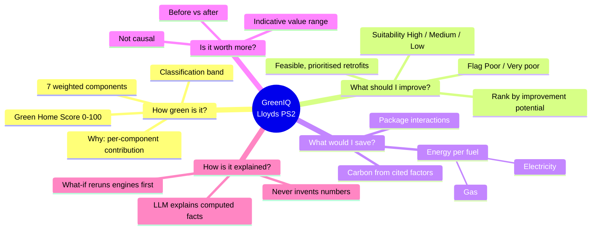
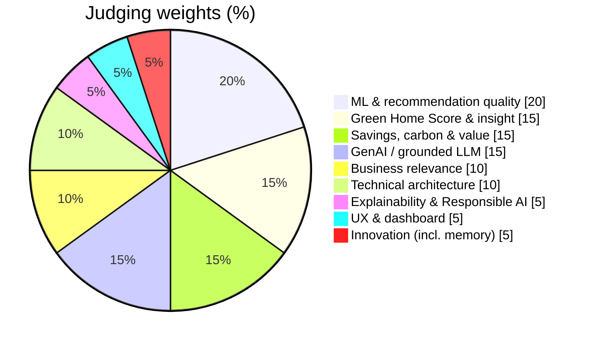

# 02 · Problem Decoded (PS2 → requirements)

> Lloyds PS2 turned into **traceable requirement IDs**. Every component, test and slide
> should point back to an ID here. The original is in
> [`reference/LLOYDS-ps2.pdf`](reference/LLOYDS-ps2.pdf); if this page and the PDF ever
> disagree, **the PDF wins.**

## The customer question we must answer

> *How green is my home today, what should I improve, how much energy and carbon could I
> save, and could this increase my property's value?*

---

## Functional requirements

| ID | Requirement (from PS2) | Must-haves |
|---|---|---|
| **FR-1** | **Green Home Score** | Weighted sum of 7 sub-scores (fixed weights, see Guardrails G4); sub-scores 0–100; documented, **monotonic** mappings; efficiency reflects the recorded rating, intensity reflects annualised metered kWh/m²; justify any input that feeds two components; round to an integer; classify into 5 bands; **show each component's contribution**. |
| **FR-2** | **Identify poorly performing homes** | Flag Poor/Very poor with **key issues**; rank by **improvement potential** = % cut in annual purchased energy (grid import + gas); baseline 0 or unknown → "unavailable", with the handling documented; report electricity and gas changes separately; solar cuts imports, not demand; **don't call a big house inefficient just because its total use is high** (use intensity and property characteristics). |
| **FR-3** | **Retrofit recommendations** | A **prioritised** list of **feasible** retrofits only (not every retrofit); each with **suitability (H/M/L)**, an estimated saving and a reason; the **order reflects interactions** (e.g. insulation before a heat pump); a documented catalogue (source + assumptions) that takes precedence over PS2's illustrative figures. |
| **FR-4** | **Energy savings** | Per retrofit **and** per package, kWh/yr, **electricity and gas separately**; a consistent baseline and a post-retrofit estimate per fuel; a fuel increase is a **negative saving**; the package accounts for interactions (not a sum); **labelled as estimates**. |
| **FR-5** | **Carbon reduction** | `ΔC = Σ ΔE_f × EF_f` per fuel; documented emission factors (units, source, year); positive = reduction. |
| **FR-6** | **Property value impact** | A **range**; before vs after for the same property with other characteristics held constant; accounts for location, size, type and market; described as an **indicative estimate based on historical/market relationships**, **not a causal claim**. |
| **FR-7** | **LLM explanation & what-if** | The LLM explains the score and recommendations and answers what-if questions **using only computed values**; for a what-if, **rerun the models first**, then explain. |
| **FR-8** | **Customer dashboard** | A working web prototype that presents FR-1…FR-7 to a customer. |
| **FR-9** | *(optional)* **Customer memory** | Persistent per-customer memory (completed retrofits, constraints, preferences, past responses) that changes later recommendations; **show how recommendations change as memory builds**; scores still come from the engines. |

### Expected outputs (PS2 §8 shape)

| Output | Shape of a good answer |
|---|---|
| Green Home Score | an integer out of 100 |
| Efficiency classification | one of the 5 bands |
| Recommended improvements | a short prioritised list of feasible retrofits |
| Annual energy savings | net kWh/yr, **with electricity and gas reported separately** |
| Annual carbon reduction | t CO₂e/yr, **calculated from the per-fuel changes** |
| Property-value impact | an **indicative % range** |

**Pipeline named by PS2:** property, energy & sales data → feature engineering → Green
Home Score → efficiency detector → retrofit engine → savings, carbon & value models →
LLM explanation → customer dashboard.

---

## Data requirements

| ID | Requirement |
|---|---|
| **DR-1** | Synthetic data, public data (within licence), or both. **No real personal/confidential data.** |
| **DR-2** | Entities roughly: properties, energy usage (monthly, per fuel), retrofit catalogue, emission factors, retrofit history, sales history, plus **reference labels** (improvement potential/ranking, retrofit feasibility/relevance, per-fuel savings, value impact). They may be adapted if they still support the outputs. |
| **DR-3** | **Property-level** train/val/test splits; **customer-level** if customers own several properties or memory is used. |
| **DR-4** | No fields unavailable at prediction time. The schema **separates the current value estimate from historical sale prices** and **marks fields unavailable at prediction time**. |
| **DR-5** | Annualise monthly usage consistently; **handle and document missing months/fields explicitly** (not zero by default). |
| **DR-6** | Document sources, schema, assumptions, limitations, the **generation process and label rules**. Labels must reflect plausible relationships and their rules must be disclosed. |
| **DR-7** | Documented emission factors (units + source) included with the submission. |

## Evaluation requirements

| ID | Requirement |
|---|---|
| **ER-1** | Documented train/val/test splits; report methodology, metrics, **baseline comparisons** and limitations. |
| **ER-2** | Compare against an **appropriate simple baseline** on our own validation data. |
| **ER-3** | **Reproducible:** organisers may rerun the code and inspect the data, labels, calculations and outputs. |
| **ER-4** | **LLM targets: groundedness ≥ 90%, factual accuracy ≥ 90%, unsupported claims < 5%.** |
| **ER-5** | Withstand **scenario tests**: missing/conflicting property data · infeasible or interacting retrofits · **higher electricity use after a heating-system change** · not enough information to estimate savings or value. |

## Submission requirements (PS2 §13)

| ID | Deliverable |
|---|---|
| **SR-A** | Working prototype (web app or dashboard) |
| **SR-B** | Source code + data prep/generation scripts + run instructions (+ dataset files where sharing is allowed) |
| **SR-C** | Trained models + inference code |
| **SR-D** | Scoring method: documented sub-score mappings |
| **SR-E** | LLM implementation: prompts, model/API details, evaluation approach |
| **SR-F** | Architecture diagram |
| **SR-G** | Evaluation report (Section 11 metrics, validation set) |
| **SR-H** | Responsible-AI note (privacy, bias, explainability, hallucination, human oversight, data limitations) |
| **SR-I** | Held-out test predictions + data schema/label documentation |

---

## How we're judged (PS2 §12)

**What the judges have told us they value:** data quality and documented labels,
validity of the held-out evaluation, reproducibility, and evidence over model
sophistication. *"Unsupported precision, arbitrary synthetic labels, or claims that exceed
what the data can establish may reduce the score."* Our architecture is designed around
that sentence.
