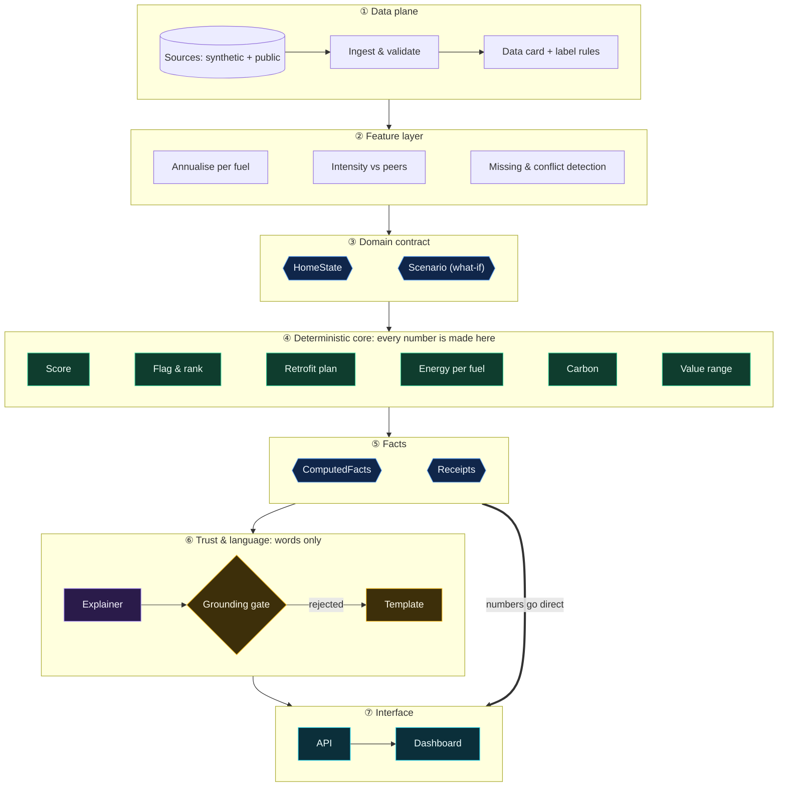
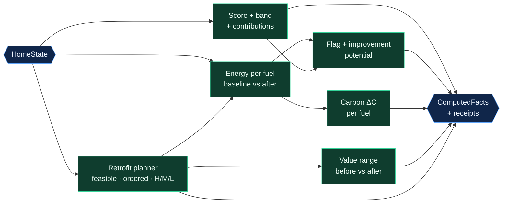
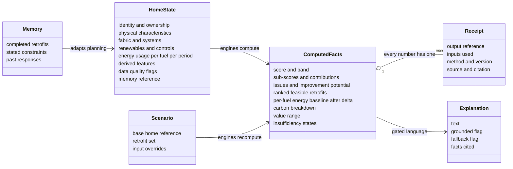
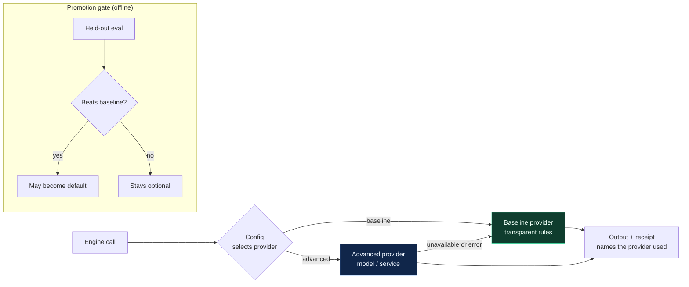
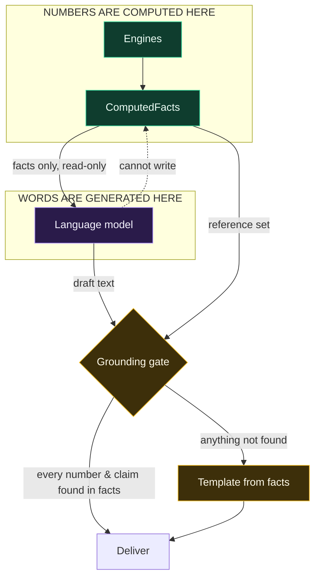

# 03 · Architecture

> The **shape** of GreenIQ: layers, components, contracts, seams and boundaries. This
> fixes *structure and responsibilities*. **The concrete methods, stack, schemas, routes
> and screens are fixed in [`11_IMPLEMENTATION_SPEC.md`](11_IMPLEMENTATION_SPEC.md)**
> (decisions: [ADR-002](adr/ADR-002-base-product-decisions.md)).

---

## 1. Design principles

| # | Principle | What it means in practice |
|---|---|---|
| P1 | **Deterministic core, language at the edge** | All numbers come from engines inside the core. Language models only exist past the trust boundary. |
| P2 | **One contract** | A single domain schema (HomeState → ComputedFacts) is how the modules talk to each other. No module reaches into another's internals. |
| P3 | **Seams everywhere intelligence lives** | Each engine sits behind an interface with a *baseline* and an *advanced* provider; config picks one; fallback is guaranteed. |
| P4 | **Receipts by default** | Every output carries provenance (inputs, method, version, source). Explainability is built in, not added afterwards. |
| P5 | **Recompute, don't imagine** | What-if = mutate the scenario → rerun the engines → explain the diff. |
| P6 | **Honest uncertainty** | Ranges, estimate labels and explicit insufficiency states are first-class outputs, not errors. |
| P7 | **Walking skeleton first** | Every layer exists end-to-end from the first hours; depth is added behind the seams later. |

---

## 2. Layered view

**Reading the diagram:** layers stack top to bottom. Everything in ④ is deterministic or
an evaluated model. Everything in ⑥ is language, and nothing there reaches ⑦ without
passing the gate. The numbers themselves go **straight** from facts to the interface
and never pass through the language model. The **what-if loop** (shown in the poster above
and in [Flow C](04_RUNTIME_FLOWS.md)) works like this: the UI changes a **Scenario**, the
engines **rerun**, and new facts exist *before* anything is explained.

### Engine dependency order (inside ④)

---

## 3. Component responsibilities

Each component has a contract (what it takes in and gives back) and two levels of
implementation. **Baseline** = transparent, documented, ships in the base product (exact
methods in `11`). **Advanced** = what may justify itself later, behind the same interface.

| Component | Responsibility | Consumes → Produces | Baseline (base product) | Advanced (later, if it beats baseline) | Reqs |
|---|---|---|---|---|---|
| **Ingest & validate** | Load sources, validate the schema, flag conflicts | raw tables → validated records | schema validation + rule checks | richer conflict resolution, real-data loaders | DR-1..7 |
| **Feature layer** | Annualise per fuel, compute intensity, benchmark vs peers, flag missingness | records → HomeState | documented annualisation + peer-group benchmark | learned imputation with uncertainty | DR-5, FR-2 |
| **Score engine** | 7 sub-scores → weighted score → band → contributions | HomeState → score facts | documented monotonic mappings | calibrated mappings (still monotonic) | FR-1 |
| **Efficiency flag & rank** | Flag Poor/Very poor, key issues, improvement potential | HomeState + energy facts → flags, rank | rules over sub-scores + the PS formula | learned issue detection | FR-2 |
| **Energy engine** | Per-fuel baseline and post-scenario kWh/yr | HomeState + Scenario → per-fuel energy | transparent physics-lite / catalogue model with an interaction rule | ML regressors per fuel (benchmarked) | FR-2, FR-4 |
| **Retrofit planner** | Feasibility filter → interaction-aware ordering → suitability | HomeState (+ memory) → ranked plan | applicability rules + dependency ordering | learned relevance ranking | FR-3, FR-9 |
| **Carbon engine** | ΔE per fuel × cited factor | energy facts → carbon facts | pure formula + factor config | — (stays deterministic) | FR-5 |
| **Value engine** | Before/after value **range** | HomeState + Scenario → value range | documented rating-premium band | regression with intervals on market data | FR-6 |
| **Facts assembler** | Merge outputs + receipts + insufficiency states | all engine outputs → ComputedFacts | always | — | all |
| **Grounding gate** | Verify every number/claim in AI text against the facts | text + facts → pass / reject | always | richer claim checks | FR-7, ER-4 |
| **Explainer / narrator** | Explain facts; narrate what-if diffs | facts (+ diff) → text | deterministic templates | LLM behind the gate | FR-7 |
| **Memory** *(optional)* | Persist constraints, completed retrofits, responses | events → memory → planner inputs | simple store, constraint filters | preference learning | FR-9 |
| **API** | Stable endpoints for every output and what-if | requests → facts / explanations | always | — | FR-8 |
| **Dashboard** | Show the answer, the why, the plan, the what-if | API → UI | always | richer visuals | FR-8 |

---

## 4. The domain contract

The schema is the team contract. Fields are listed **conceptually**; the build team names
them precisely.

**Contract rules:** facts are **immutable per computation** (a what-if produces a *new*
facts object, which is diffed against the old one); every numeric field has a receipt;
"unknown" is a value, not a missing key; current value estimate ≠ historical sale price.

---

## 5. The provider-seam pattern

Every intelligent step uses the same pattern, so advanced work never destabilises the
base product.

Seams to expose (minimum): **score mapping · energy · retrofit ranking · value ·
narrator · memory.** Each receipt records **which provider produced the number**, so
the UI can show it (observability that judges can see).

---

## 6. The trust boundary

Information flows **one way**: facts → language. The language layer has **no write
path** into facts, engines or scores.

---

## 7. Mechanisms worth borrowing (from prior work and research)

The team's earlier projects proved out these mechanisms. Re-implement them **for this
domain** (Guardrail G2). **Full detail, sketches, gotchas and tests are in
[`10_MECHANISMS_HANDBOOK.md`](10_MECHANISMS_HANDBOOK.md).** It's already distilled, so
don't re-derive it.

| Mechanism | Why it matters here |
|---|---|
| **Grounding gate + template fallback** | Hits ER-4 (≥90% grounded, <5% unsupported) by construction, not by hoping |
| **Shared schema as team contract** | Parallel work without integration chaos |
| **Provider seams with guaranteed fallback** | Base product stays green while advanced work happens |
| **Per-output receipts / provenance** | "Show why it got this score" (FR-1) and explainability scoring |
| **Decision layer** (score → band → review/insufficiency queue) | Honest handling of missing/conflicting data (ER-5) |
| **Peer-baseline / percentile lane** | Fair intensity scoring ("big house ≠ inefficient") and "compare to similar homes" |
| **Benchmark-before-replace + honest eval harness** | ML quality (20%) is judged on held-out evidence vs baselines |
| **Orchestrator + pluggable modules** | Clean pipeline coordination; easy to add memory and new engines |
| **"Which model produced this" observability** | Makes the deterministic discipline *visible* in the demo |
| **Completeness / missing-field detection** | DR-5 and the "insufficient information" scenarios |

---

## 8. Quality attributes (what "good" looks like)

| Attribute | Target behaviour |
|---|---|
| **Correctness** | PS formulas exact; monotonicity provable by test; per-fuel signs right (e.g. a heating change can raise electricity) |
| **Explainability** | Any number → its receipt in one click |
| **Groundedness** | ≥90% grounded, ≥90% factually accurate, <5% unsupported (ER-4) |
| **Responsiveness** | Deterministic outputs and what-if recompute feel instant; language explanation is incremental, and template text appears immediately while it loads |
| **Resilience** | No key, no model, no network → still fully usable (baseline + template) |
| **Reproducibility** | One command to run, one command to evaluate, same numbers every time |
| **Cost** | Language calls are small (facts-only context), cacheable, and optional |
| **Extensibility** | A new engine/provider/feature plugs in without touching the core contract |
