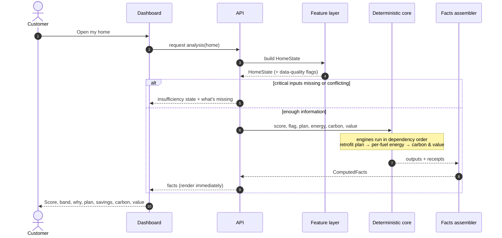
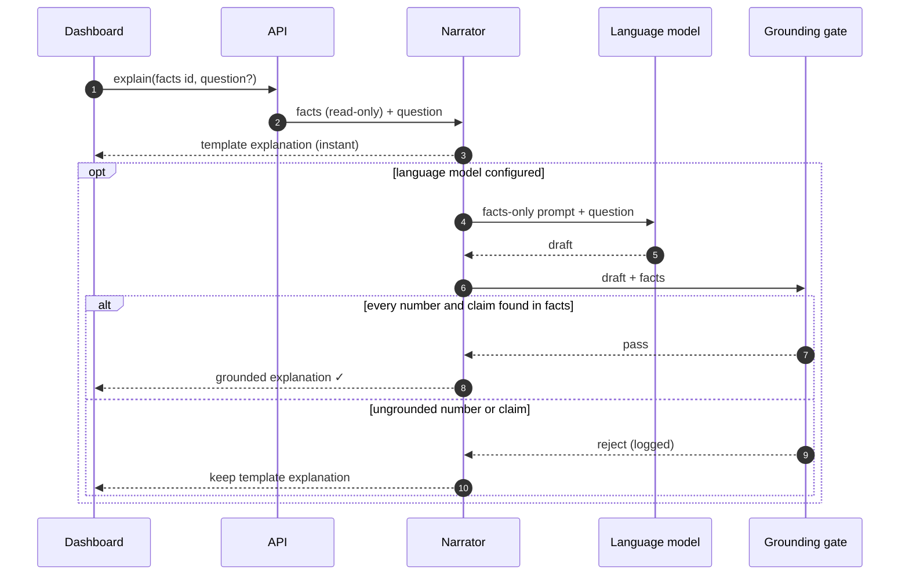
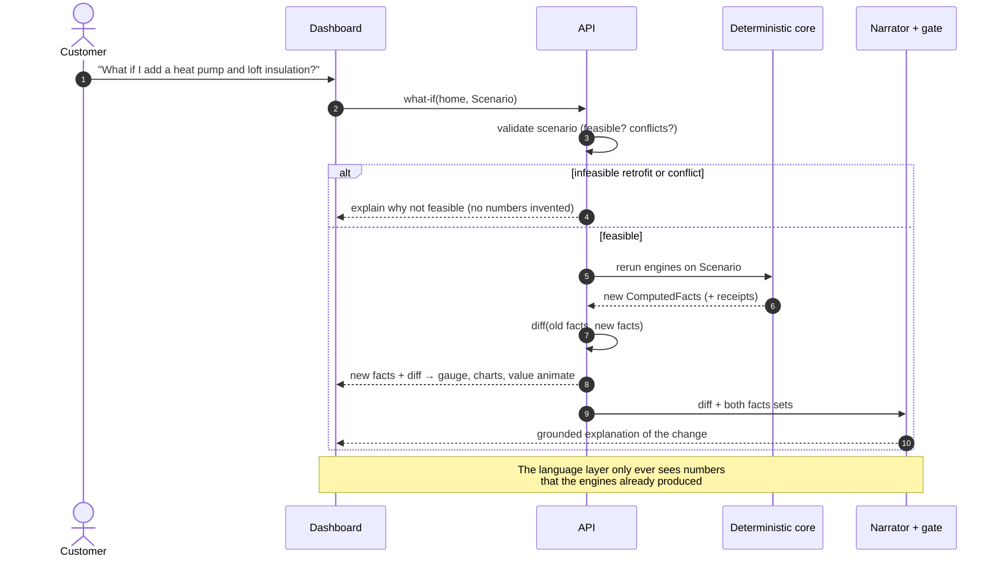
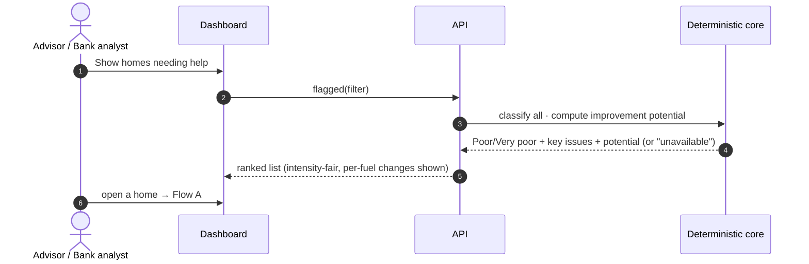
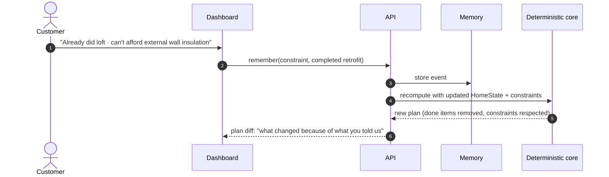
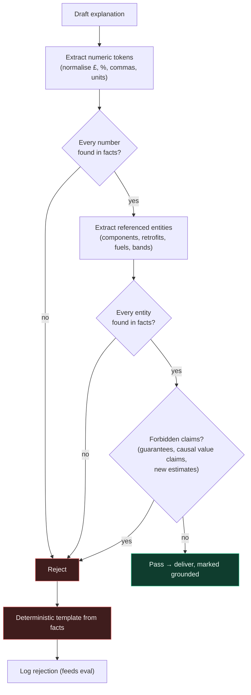
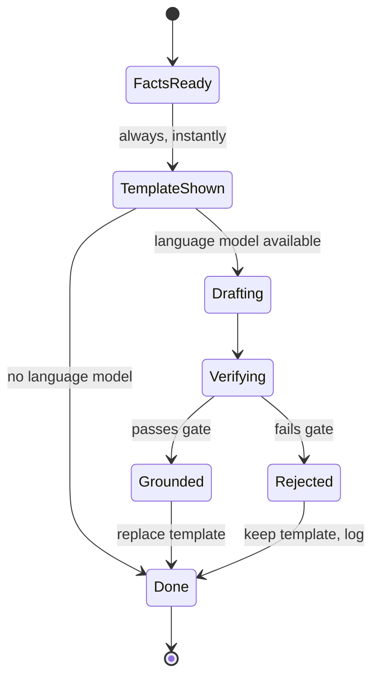

# 04 · Runtime Flows

> How a request actually moves through the system. These sequences define the
> **behaviour** the base product must have. Participant names are roles, not file
> names. Exact routes and payloads: [`11_IMPLEMENTATION_SPEC.md`](11_IMPLEMENTATION_SPEC.md) §8–§9.

---

## Flow A — Analyse a home (the core answer)

## Flow B — Explain (grounded language)

## Flow C — What-if (recompute, then explain) — the signature interaction

## Flow D — Portfolio: find & rank poor homes

## Flow E — Customer memory *(optional extension)*

---

## The grounding gate (decision logic)

> **Implementation note:** the base product uses **structured, citation-bound
> verification** (`11` §8.3). Each LLM sentence carries `fact_ids`, and each number must
> match the display value of a fact that sentence cites. The diagram below shows the
> checks in order; "found in facts" means "found in the sentence's cited facts".

## Explanation lifecycle

---

## Behaviour under the organisers' scenario tests (ER-5)

| Scenario | Required behaviour |
|---|---|
| Missing property fields | Score what can be scored; mark affected components; show an insufficiency state where a number would be a guess |
| Conflicting data (e.g. "heat pump" but very high gas use) | Flag the conflict, explain it, lower confidence; never silently pick one |
| Infeasible retrofit requested (e.g. loft insulation in a mid-floor flat) | Refuse with the reason; offer the feasible alternatives |
| Interacting retrofits | Package result ≠ sum of parts; explain the interaction |
| Electricity rises after a heating change | Shown as a **negative electricity saving** next to the gas saving; carbon nets both |
| Not enough data for savings/value | "Unavailable" with the reason, not a fabricated range |
