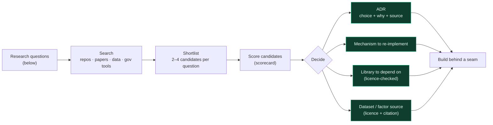
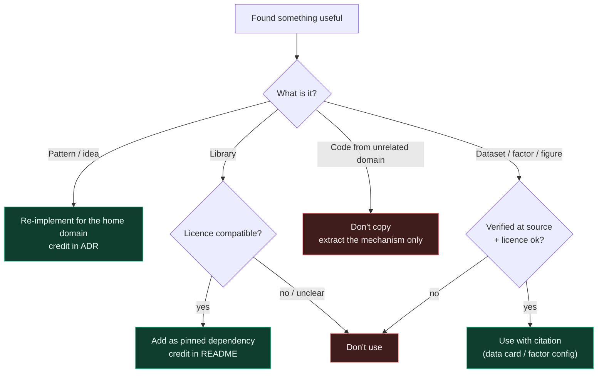

# 05 · Research Playbook

> **Status: RESOLVED for the base product.** RQ-1…RQ-11 below were answered by the
> architecture finalisation and are fixed in
> [`11_IMPLEMENTATION_SPEC.md`](11_IMPLEMENTATION_SPEC.md) and
> [ADR-002](adr/ADR-002-base-product-decisions.md). The build session does **not**
> re-research them. It only confirms values tagged [E?]. Keep this playbook for **future
> improvements** (advanced providers behind the seams).
>
> | RQ | Resolved in `11` |
> |---|---|
> | RQ-1 sub-score mappings | §5.2 |
> | RQ-2 fair intensity benchmark | §5.2 (peer medians, TRAIN only) |
> | RQ-3 energy model + interactions | §6.2, §6.5 |
> | RQ-4 retrofit catalogue + ordering | §6.4 |
> | RQ-5 emission factors | §6.7 (DESNZ 2026) |
> | RQ-6 value method | §7 |
> | RQ-7 data | §3 (NEED 2026 + augmentation) |
> | RQ-8 LLM + grounding | §8 |
> | RQ-9 measuring grounding | §8.3, §12.2 |
> | RQ-10 stack | §1–§2 |
> | RQ-11 customer memory | deferred (optional in PS2) |
>
> The build team **researches before it decides** future upgrades. This playbook says
> *what to find out, where to look, how to judge it, and how to turn findings into
> decisions*. Research is **proportionate**: it serves the build, it doesn't replace it.

---

## 1. Research questions (answer each with an ADR)

| # | Question | Feeds |
|---|---|---|
| RQ-1 | How should each of the 7 sub-scores map from inputs to 0–100 so that it's **monotonic, defensible and documented**? What does established methodology (e.g. UK rating/assessment practice) suggest? | FR-1, SR-D |
| RQ-2 | How do we benchmark **consumption intensity fairly** across property types and sizes? | FR-1, FR-2 |
| RQ-3 | What is a credible, transparent **baseline energy model per fuel**, and what's the right **interaction rule** for retrofit packages? | FR-2, FR-4 |
| RQ-4 | What does a defensible **retrofit catalogue** look like (applicability, typical impact, cost, source)? What ordering logic do established advisors use? | FR-3 |
| RQ-5 | Which **emission-factor source and year** do we cite, and on what basis (gross/net, location-based, etc.)? | FR-5, DR-7 |
| RQ-6 | How do we estimate **value impact as a range** with honest non-causal framing? What market data or published relationships exist? | FR-6 |
| RQ-7 | What **data** do we use: synthetic generator design, public datasets, label-generation rules, splits? | DR-1..7 |
| RQ-8 | Which **language model and prompting pattern** give grounded explanations cheaply? What grounding / claim-verification techniques exist? | FR-7, ER-4 |
| RQ-9 | How do we **measure** groundedness, factual accuracy and unsupported claims reproducibly? | ER-4, SR-E |
| RQ-10 | Which **stack** (backend, ML, UI, packaging) gets us a clean, fast, reproducible base product with the least friction? | all |
| RQ-11 | What would **customer memory** need in order to visibly change recommendations? | FR-9 |

## 2. Where to look

- **Already done, so skip it:** the team's earlier projects have been analysed and
  distilled into [`10_MECHANISMS_HANDBOOK.md`](10_MECHANISMS_HANDBOOK.md). Don't spend
  research time on them. Research is for **new, external** knowledge only.
- **GitHub / open source.** Search for home energy rating and assessment, retrofit
  recommendation, energy performance certificate data tooling, metered-savings
  methodologies, explainable recommenders, grounded/attributed LLM generation, and
  claim verification.
- **Government and industry tools and methods.** Official home energy advice tools and
  their published methodology, national rating/assessment methodologies, official
  greenhouse-gas conversion factors.
- **Open datasets.** PS2 itself suggests four (energy performance certificates,
  smart-meter consumption, national consumption framework, price-paid data). Treat them
  as starting points, check their licences, and expect them **not** to join neatly at
  property level.
- **Research papers.** Retrofit recommendation, building energy prediction, explainable
  ML for retrofits, synthetic tabular data, value effects of energy ratings (note what
  they say about causality).

> **Leads are not facts.** Verify every number, licence and claim at the source before it
> enters the build. Cite what you use. If you can't verify it, don't ship it.

## 3. Candidate scorecard

Score each shortlisted repo, dataset or method from 0 to 3 on each line. Prefer the
highest total, but **a 0 on licence or verifiability disqualifies it.**

| Criterion | 0 | 3 |
|---|---|---|
| **Licence safety** | unknown / incompatible | permissive, clearly stated |
| **Relevance to a PS2 requirement** | tangential | directly satisfies one |
| **Verifiability** | unsourced claims | documented, citable |
| **Mechanism value** | trivial | a reusable pattern we'd otherwise invent |
| **Integration cost** | days of glue | minutes, behind a seam |
| **Maintenance / maturity** | abandoned, broken | active, tested |

## 4. Borrow protocol

## 5. Research outputs (what must exist afterwards)

- `docs/research/RESEARCH_NOTES.md`: per RQ, what was found, the shortlist, the
  scorecard and the decision. Short and linkable.
- `docs/research/SOURCES.md`: every repo, dataset, paper and factor source used, with
  links, licences and what it was used for.
- `docs/adr/ADR-0xx-*.md`: one short ADR per significant decision (template in
  [`adr/`](adr/)).
- `data/DATA_CARD.md`: sources, schema, generation process, label rules, splits,
  limitations.

## 6. Efficiency

- **Research just deeply enough to decide.** Once one option is clearly verified and
  good enough, record it as an ADR and build. Better options can come later behind the
  seam.
- **Parallelise:** independent questions can be researched concurrently (e.g. data and
  factors at the same time as stack and UI, and grounding techniques at the same time
  as score mappings).
- **Bias to baseline:** if research doesn't produce a clearly better, verifiable option,
  the transparent baseline ships. That is a legitimate, well-scored outcome.
