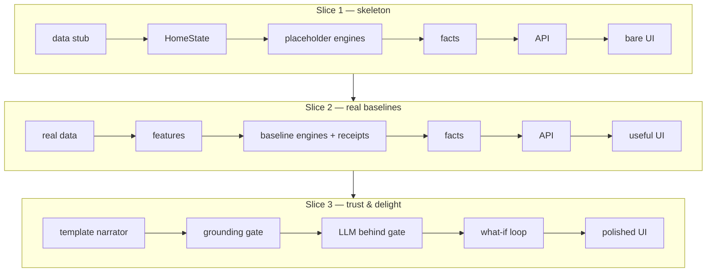
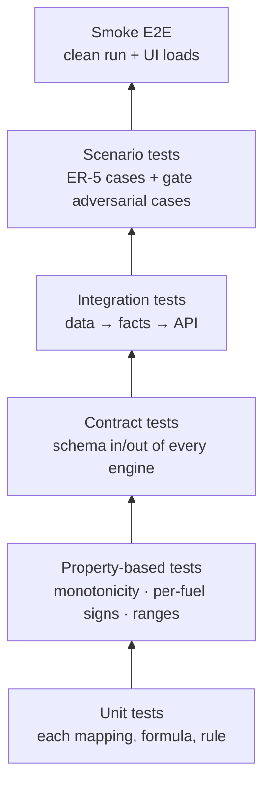

# 06 · Build Framework

> **How** to build: phases with entry/exit gates, the walking-skeleton strategy, the
> expected repository shape, conventions, and testing. The target is the **complete base
> product**: every mandatory PS2 requirement implemented and integrated at a credible,
> transparent baseline, with plug-in points for advanced work.
>
> **Final decisions now live in [`11_IMPLEMENTATION_SPEC.md`](11_IMPLEMENTATION_SPEC.md)**
> (stack, layout, methods, tests). Where this page and `11` differ, `11` wins.

---

## 1. Phases and gates


| Phase | Goal | Exit gate (all must be true) |
|---|---|---|
| **P0 Orient** | Understand scope and rules | Requirements in `02` mapped to a checklist |
| **P1 Verify** | RQ-1…RQ-11 are already resolved in `11`; confirm only the items tagged [E?] | Confirmations recorded in `docs/DECISIONS.md` |
| **P2 Decide** | Stack and methods are fixed by `11` / ADR-002; decide only minor details | Exact dependency versions pinned; licences checked |
| **P3 Contract** | Domain schema + data | Schema defined; data generated/loaded; splits saved; data card drafted |
| **P4 Skeleton** | Every layer exists end-to-end | One home goes data → facts → API → UI, even with placeholder logic; one command runs it |
| **P5 Baseline engines** | Real, transparent logic for FR-1…FR-6 | Every output is computed, receipted and tested; insufficiency states work |
| **P6 Trust layer** | Explain + what-if, safely | Template narrator works with no key; gate blocks invented numbers (tested); what-if reruns engines and returns a diff |
| **P7 Experience** | A dashboard a customer understands | Score, why, plan, per-fuel savings, carbon, value range, what-if and assistant all visible |
| **P8 Evidence** | Prove it | Eval runs with one command; metrics vs baselines on held-out data; grounding metrics; docs for SR-A…SR-I |
| **P9 Harden** | Judge-proof | A fresh clone runs with no keys from the README alone; tests green |
| **P10 Advanced** | Depth (later) | Each upgrade beats the baseline on held-out data, or stays optional |

**Rule:** never start phase N+1 with phase N's exit gate red, **except** that P5–P7 can
overlap once P4 is green.

---

## 2. Walking skeleton first



Each slice is **demoable and submittable**. Depth goes in behind seams; the skeleton
never gets rewritten.

---

## 3. Definition of Done — the base product

> Binding detail: every acceptance test in [`12_REQUIREMENTS_MATRIX.md`](12_REQUIREMENTS_MATRIX.md)
> and `11` §12 passes. Placeholders from the skeleton phase may not remain.

**Functional**
- [ ] FR-1…FR-8 work end-to-end for any home in the dataset (FR-9 customer memory is
  optional in PS2 and deferred; its seam is reserved)
- [ ] Every number has a receipt; the UI can show it
- [ ] Insufficiency states exist and are explained (ER-5 scenarios handled)
- [ ] What-if reruns the engines and returns a diff; the explanation covers only the diff

**Trust**
- [ ] Grounding gate active on all language output, with a deterministic template fallback
- [ ] Works fully with **no API key** (template mode)
- [ ] The gate has a test proving it rejects an invented number

**Evidence**
- [ ] Property-level splits saved; no leakage (tested)
- [ ] One-command evaluation → report with metrics vs simple baselines on held-out data
- [ ] Grounding metrics reported against ER-4 targets
- [ ] Held-out predictions + schema exported

**Engineering**
- [ ] One command to set up and run; README written for a stranger
- [ ] Pinned dependencies; fixed seeds; `.env.example`; no secrets in git
- [ ] Seams exposed for score mapping, energy, retrofit ranking, value, narrator, memory
- [ ] Tests green (see §5)

**Documentation** (maps to SR-A…SR-I)
- [ ] Architecture diagram (adapt from `03`) · scoring methodology · LLM prompts + model
  details + eval approach · data card · evaluation report · Responsible-AI note · ADRs ·
  sources

---

## 4. Repository shape (roles, not prescriptions)

The build team chooses exact names. The **roles** should be recognisable:

```
/                          README (run, reproduce, architecture link), one-command entrypoints
├─ data/                   generator / loaders, splits, catalogue & factor config, DATA_CARD
├─ backend/                domain package:
│   ├─ contract            the schema (HomeState, Scenario, ComputedFacts, Receipt, Explanation)
│   ├─ features            annualisation, intensity, benchmarks, missing/conflict detection
│   ├─ engines             score · flag/rank · energy · retrofit · carbon · value (each behind a seam)
│   ├─ trust               facts assembly, grounding gate, narrator (template + LLM)
│   ├─ memory              optional customer memory
│   ├─ api                 HTTP layer
│   ├─ train               model training (seeded)
│   ├─ eval                evaluation harness → report + held-out predictions
│   └─ tests               unit · property-based · contract · integration
├─ frontend/               dashboard (components per output + what-if + assistant)
└─ docs/                   this pack + research notes + ADRs + generated reports
```

## 5. Testing strategy



**Tests the judges will indirectly run (make them pass on purpose):**
monotonicity of every sub-score · PS formulas exact · baseline-zero → unavailable ·
heating change can raise electricity (negative saving shown) · package ≠ sum of parts ·
infeasible retrofit refused · no property shared across splits · gate rejects invented
figures · app runs with no key.

## 6. Conventions

- **Small, described commits.** The history should tell the build story.
- **Every engine output = value + unit + receipt (+ confidence/insufficiency if relevant).**
- **Units always explicit** (kWh/yr, kWh/m²/yr, kg or t CO₂e/yr, £). Never bare numbers.
- **Display precision matches evidence** (round estimates sensibly; no false precision).
- **Language layer is stateless**; it receives facts and returns text.
- **Config over code** for weights (PS-fixed), factors, catalogue and provider selection.

## 7. Anti-patterns (don't)

- ❌ Letting the LLM compute, "estimate" or round a number
- ❌ Collapsing electricity and gas into one figure without the split
- ❌ Zero-filling missing months or fields
- ❌ Summing individual retrofit savings to get a package
- ❌ A value "uplift" as a single number or a causal claim
- ❌ Tuning on the test split, or the same property appearing in two splits
- ❌ An ML model as the default without a baseline comparison
- ❌ Features that break the clean run
- ❌ Copying domain code from unrelated reference projects
