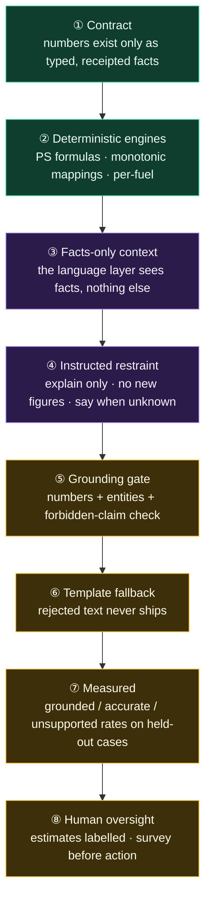
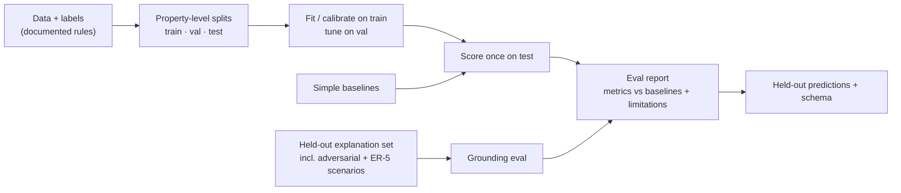

# 07 · Trust & Evaluation

> How GreenIQ earns trust: layered defences against hallucination and false precision,
> an evaluation framework judges can rerun, and the Responsible-AI position.

---

## 1. Defence in depth against hallucination

No single layer has to be perfect, because each one catches what the previous missed.

## 2. Failure modes & designed responses

| # | Failure mode | Where it would bite | Designed response |
|---|---|---|---|
| F1 | LLM invents or alters a figure | Explanations, what-if | Gate rejects → template; logged; counted in eval |
| F2 | LLM implies a guarantee or causality | Value / savings text | Forbidden-claim check in the gate; required estimate/indicative wording |
| F3 | Missing months distort annual energy | Intensity, savings | Explicit annualisation rule + coverage flag; insufficiency below a documented threshold |
| F4 | Conflicting inputs | Any engine | Conflict detection → flagged, explained, lower confidence |
| F5 | Infeasible retrofit recommended | Retrofit plan | Applicability rules before ranking; what-if refuses with a reason |
| F6 | Package savings over-stated | FR-4 | Interaction rule; tested so package ≠ sum |
| F7 | Heating change hides an electricity increase | FR-4/5 | Per-fuel reporting; negative saving shown; carbon nets per fuel |
| F8 | Large home unfairly penalised | FR-1/2 | Intensity benchmarked by peer group, not total kWh |
| F9 | Leakage inflates metrics | Evaluation | Property/customer-level splits; prediction-time field audit; leakage test |
| F10 | Synthetic labels oversold | Report, pitch | Label rules disclosed; "agreement ≠ real-world accuracy" stated |
| F11 | Value uplift read as a promise | FR-6 | Range only; indicative/non-causal caption in UI and text |
| F12 | API key/model unavailable at demo | Everything | Baseline + template mode is complete on its own |

## 3. Evaluation framework

> Exact metrics, baselines and data per area are **fixed in
> [`11_IMPLEMENTATION_SPEC.md`](11_IMPLEMENTATION_SPEC.md) §12.2**; this table is the rationale.

| Area | What to measure | Compared against |
|---|---|---|
| **Score** | Monotonicity (pass/fail across perturbations), distribution sanity, a worked example matching the PS2 narrative | — (deterministic) |
| **Energy (per fuel)** | Error and fit on held-out homes, **reported separately for electricity and gas** | A naive baseline (e.g. peer-group mean intensity × area) |
| **Improvement potential / ranking** | Ranking agreement with the reference labels | A naive ordering |
| **Retrofits** | Feasibility violations (should be zero), relevance vs labels, ordering sanity | Rule-only or popularity baseline |
| **Savings & carbon** | Per-fuel agreement with held-out reference estimates; sign correctness | Catalogue-midpoint baseline |
| **Value** | Error on held-out properties + **range coverage** | Rating-premium baseline |
| **Language** | **Grounded rate ≥ 90% · factual accuracy ≥ 90% · unsupported claims < 5%**, plus gate rejection rate and an adversarial suite | Ungated LLM (to show what the gate buys) |
| **System** | Response time of deterministic vs language paths; language cost per explanation | — |

**How to score language outputs (reproducibly):** the model returns structured
sentences, each citing the `fact_ids` it relies on (`11` §8.2). For each claim, check
that the cited facts exist and that every number matches the display value of a fact
*that sentence cites* (`11` §8.3). Citations bind, so naive "the number appears
somewhere" matching is not enough. That gives you grounded = supported/total, accuracy = correct/total and
unsupported = unsupported/total. Keep the evaluation set fixed and versioned, and include
deliberately adversarial prompts (asks for numbers that don't exist, pressure for
guarantees, causal value claims).

## 4. Responsible-AI position (seed for SR-H)

| Topic | Our position |
|---|---|
| **Privacy** | No real personal or customer data. Public data within its licence; synthetic otherwise. Memory stores only what the user states, and can be deleted. |
| **Bias** | Coverage gaps (property types, regions, ages), class imbalance across bands, and peer-group choices are documented. We check score and error distribution by property type and region. |
| **Explainability** | Deterministic core, per-component contributions, receipts on every number, grounded narration. |
| **Hallucination** | Defence in depth (§1); measured against ER-4 targets; rejections logged. |
| **Human oversight** | All figures are estimates. A survey or qualified assessor confirms before any action. Insufficiency states route to a human. |
| **Data limitations** | Synthetic labels are not ground truth. Public datasets join imperfectly. Value impact is indicative and non-causal. Emission factors are dated to a stated year. |
