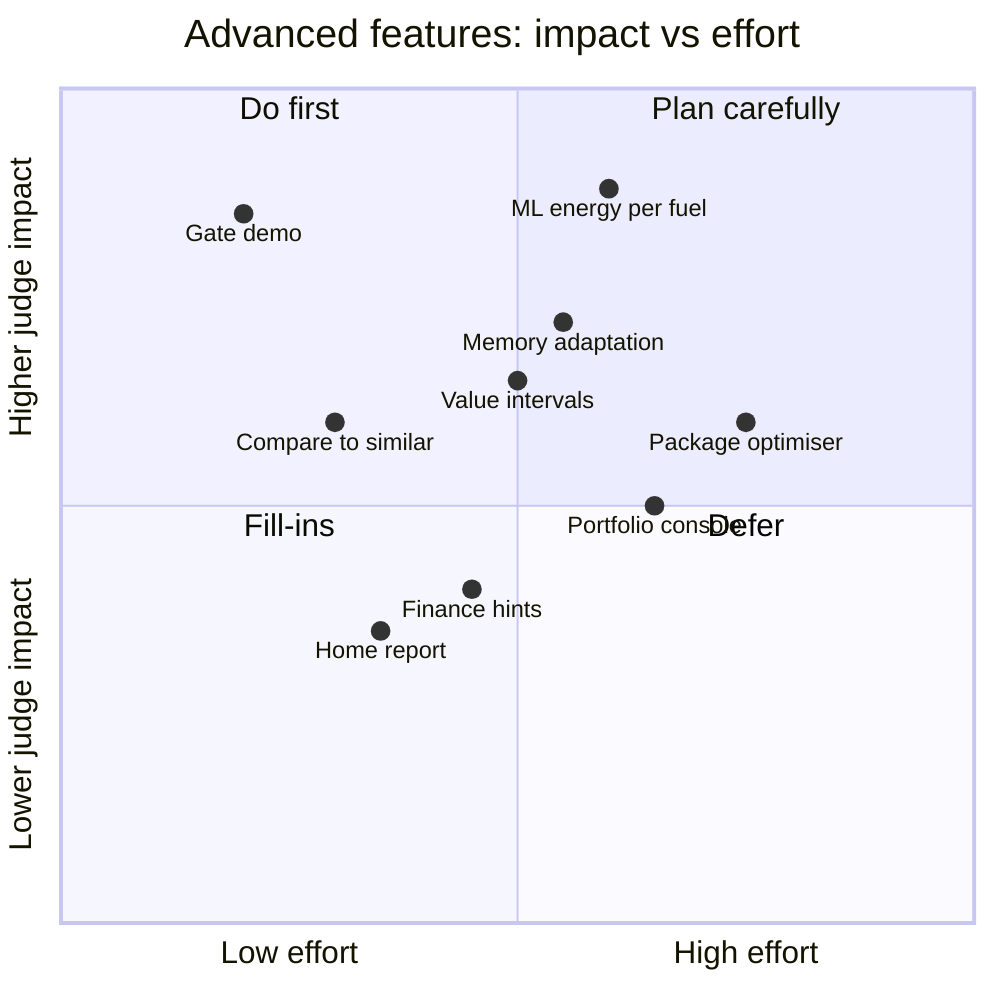
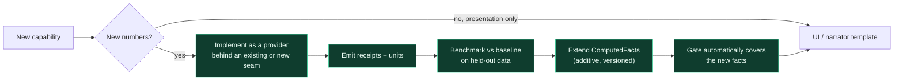

# 08 · Extensibility Roadmap

> The base product is a **platform**, not a demo. This page lists the extension points
> it must expose and the advanced features we expect to plug into them later, so
> nobody has to reopen the core to add them.

---

## 1. Three tiers

## 2. Extension points (the base product must expose these)

| Seam | Base-product provider (see `11`) | Plug-in later | Must not change |
|---|---|---|---|
| **Data source** | generator / file loader | real public datasets, partner feeds | the HomeState contract |
| **Score mapping** | documented rule tables | calibrated (still monotonic) mappings | PS weights, bands, monotonicity |
| **Energy** | transparent per-fuel model | ML regressors per fuel | per-fuel outputs + receipts |
| **Retrofit ranking** | applicability + ordering rules | learned relevance, cost-benefit | feasibility-first; H/M/L output |
| **Value** | rating-premium band | regression with intervals | range output; non-causal framing |
| **Narrator** | templates + `claude-opus-5-5` behind the citation-bound verifier | other models/vendors | the verifier; facts-only input |
| **Memory** | deferred (seam reserved) | customer memory with visible adaptation | engines still compute every number |
| **Optimiser** | — | best package under a budget/constraints | reuses the engines; no new maths in language |

## 3. Advanced feature backlog

| Feature | Why it wins points | Plugs into | Depends on |
|---|---|---|---|
| **Per-fuel ML energy models** | ML quality (20%) with held-out evidence | Energy seam | Splits, baseline, eval harness |
| **Value model with prediction intervals** | Savings/carbon/value (15%); honest ranges | Value seam | Sales history, eval |
| **Customer memory with "what changed and why"** | Innovation + optional extension, visible adaptation | Memory seam + planner | Contract memory field |
| **Compare-to-similar homes** | Insight + UX; fair benchmarking made visible | Feature layer peer groups | Benchmarks |
| **Budget-constrained package optimiser** | Business relevance; "best plan for £X" | Optimiser seam (calls engines) | Catalogue costs, interaction rule |
| **Gate visibility & adversarial demo** | GenAI (15%): proves grounding live | Narrator + UI | Gate logs |
| **Advisor / portfolio console** | Business relevance for a bank: find, rank and act on many homes | API + UI | Flow D |
| **Finance & grant pathway hints** | Business relevance (lender angle), presented as information not advice | Plan output + UI | Documented sources only |
| **Shareable home report** | UX; a takeaway for the customer | API + UI | Facts + receipts |
| **Accessibility & plain-language mode** | UX + responsible AI | Narrator + UI | Templates |

## 4. Prioritisation (value vs effort — a starting view, re-assess after research)

## 5. How a new feature plugs in (without touching the core)

**Rule of thumb:** if a feature needs the language layer to produce a number, it is
designed wrong. Move the number into an engine.
