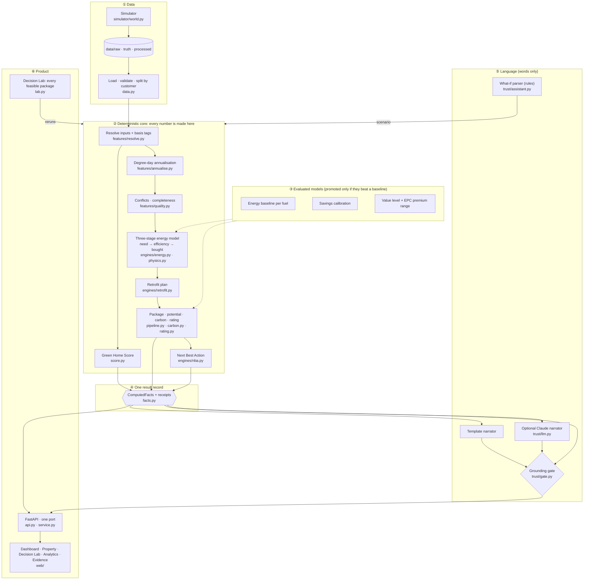

# GreenIQ architecture, as built (submission artifact F)

> The design rationale is in [`03_ARCHITECTURE.md`](03_ARCHITECTURE.md). This page shows what the code
> actually does, with module paths.

## The one rule, structurally
- Numbers flow **only** from ② (and the evaluated models in ③) into ④. The UI, the Next Best Action,
  the Decision Lab and the language layer all **read** `ComputedFacts`; none of them calculates.
- A what-if (typed question, picked measures, Decision Lab package) is a new `Scenario`. The engine
  reruns and produces a new `ComputedFacts`; only then is anything explained.
- The language layer has no write path into facts, and its output passes the gate or is replaced.

## Commands
| Command | What it does |
|---|---|
| `uv run greeniq generate` | regenerate `data/` from the seeded simulator |
| `uv run greeniq train` | fit models on train; tune and promote on validation → `models/` |
| `uv run greeniq evaluate` | score the held-out test split once → `reports/EVALUATION.md` |
| `uv run greeniq eval-grounding` | gate false-block and catch rates (and the LLM, if a key exists) → `reports/GROUNDING.md` |
| `uv run greeniq edge-sweep` | every PS2 scenario invariant over all homes → `reports/EDGE_CASES.md` |
| `uv run greeniq analyse P00007` | one home in the terminal |
| `uv run python -m greeniq serve` | API + dashboard at http://127.0.0.1:8000 |
| `uv run pytest` | test suite |
