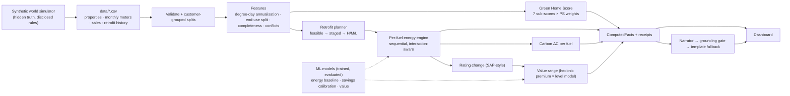

# GreenIQ: Build Journal & Current State

> **This is the living document for the v1 build.** It is updated and pushed to the
> `beautiful` branch at the end of every phase (and whenever something important
> changes), so the team can follow the build as it happens. If you read one file, read
> this one. Newest log entries are at the bottom of §7.

**Branch:** `beautiful` · **Started:** 2026-10-10 · **Builder:** Claude Code (Opus 5.5), working with Suryansh

---

## 1. Status board

| Phase | What it delivers | Status |
|---|---|---|
| **0** Audit & plan | Requirement matrix, architecture, decisions, risk register (this doc) | ✅ done |
| **1** Contract + Green Home Score | Domain schema; 7 monotonic sub-scores; PS weights; bands; receipts; tests | ✅ done (36 tests green) |
| **2** Data | Synthetic "world" simulator, monthly per-fuel meter data, sales, retrofit history, validation, customer-grouped splits, data card, golden fixtures | ✅ done (48 tests green) |
| **3** Engines | Per-fuel energy, retrofit feasibility + sequencing, interactions, carbon, rating change, conflicts, receipts | 🔄 next |
| **4** ML + evaluation | Energy models vs baselines, savings calibration, value model + ranges, ranking eval, held-out predictions, report | ⬜ |
| **5** API + persistence + memory | FastAPI, SQLite, scenarios, customer memory | ⬜ |
| **6** Dashboard | One-port web app: score, fingerprint, plan, scenario lab, roadmap, portfolio, receipts | ⬜ |
| **7** Grounded AI | Template narrator, grounding gate, Claude behind the gate, what-if assistant, groundedness eval | ⬜ |
| **8** Hardening | End-to-end tests, adversarial inputs, fresh-clone run | ⬜ |
| **9** Delivery | README, methodology, Responsible AI, architecture, BUILD_REPORT | ⬜ |

### How to run (verified commands only; grows each phase)

```bash
uv sync                      # create .venv with pinned dependencies (uv.lock)
uv run greeniq generate      # rebuild data/ from the simulator (seed 42, ~6 s)
uv run pytest                # run the test suite
```

> Machine note: on a machine with ROS installed, `PYTHONPATH` leaks ROS pytest plugins
> into the venv. Prefix commands with `env -u PYTHONPATH` there. Judges' machines
> won't need this.

---

## 2. Phase 0 audit: what exists today

| Item | Finding |
|---|---|
| `main` | Architecture & build pack only (docs 01–10, ADR-001, PS2 PDF, system SVG). **No application code, no data, no tests.** |
| `atharva` | One commit that replaces the README with `# Absolut / hello`. Nothing to merge. |
| `beautiful` | Created from `main`. All v1 work lands here. |
| Problem statement | `docs/reference/LLOYDS-ps2.pdf` (same content as the condensed 15-slide briefing). It is the source of truth. |
| Machine | Python 3.12 via `uv`; Node 18 but **no npm**. This drives the frontend decision (ADR-002). |

**What we keep:** the whole pack. Its rules (docs/01), requirement IDs (docs/02), architecture
(docs/03), flows (docs/04) and mechanisms (docs/10) are good, and they agree with the
team's pasted plans. **We build on it rather than restart.**

**Where the pasted plans and the pack disagree, and what v1 does:**

| Topic | Pasted plan said | Pack said | v1 decision |
|---|---|---|---|
| Frontend | React + Vite + Tailwind + Recharts | "choose a stack for a one-command starter" | **No-build web app** (HTML + modern JS + SVG charts) served by FastAPI on one port. A fresh clone needs only Python. See ADR-002. |
| Sessions | 3 separate Claude sessions with approval stops | one build session, keep it runnable | One continuous build, phase by phase, **each phase committed and pushed with this journal updated**, so you can stop me at any point. |
| ML | "XGBoost/LightGBM" | "evidence over sophistication" | scikit-learn gradient boosting (no extra native deps), always benchmarked against a simple baseline. |
| Weights | fixed | fixed | Fixed: 25/20/15/15/10/10/5, unit-tested. |

---

## 3. Requirement → implementation matrix

Every PS2 requirement (IDs from [docs/02](02_PROBLEM_DECODED.md)) and where it will live.
The **Status** column is updated as phases land.

| ID | Requirement | Where it is implemented | Proof (test / artifact) | Status |
|---|---|---|---|---|
| FR-1 | Green Home Score, 7 fixed weights, monotonic sub-scores, bands, contributions | `greeniq/score.py`, `greeniq/config/score_mappings.py` | `tests/test_score.py` (weights, bands, half-up rounding, property-based monotonicity) | ✅ engine done; wired into the pipeline in Phase 3 |
| FR-2 | Flag Poor/Very poor, key issues, rank by improvement potential, per fuel, fair to big homes | `greeniq/engines/ranking.py` | ranking tests; "rank by total kWh" vs ours in eval | ⬜ |
| FR-3 | Feasible retrofits only, H/M/L, reasons, interaction order | `greeniq/engines/retrofit.py`, `greeniq/config/retrofit_catalogue.json` | feasibility tests (flat ≠ loft/solar/ASHP), zero violations in eval | ⬜ |
| FR-4 | Per retrofit and per package savings, elec and gas separate, negative savings, not a sum | `greeniq/engines/energy.py` | heat-pump test (elec ↑, gas ↓), package ≠ sum test | ⬜ |
| FR-5 | ΔC = ΣΔE_f × EF_f with documented factors | `greeniq/engines/carbon.py`, `greeniq/config/emission_factors.json` | sign/unit tests | ⬜ |
| FR-6 | Value impact as an indicative, non-causal range | `greeniq/engines/value.py`, `greeniq/ml/value_model.py` | range tests, coverage in eval | ⬜ |
| FR-7 | LLM explains computed facts only; what-if reruns engines first | `greeniq/trust/` (gate, narrator, assistant) | gate rejects invented numbers; what-if recompute test | ⬜ |
| FR-8 | Customer dashboard | `greeniq/web/` served by `greeniq/api.py` | E2E smoke test | ⬜ |
| FR-9 | Customer memory (optional) | `greeniq/memory.py` | "plan changes as memory builds" test | ⬜ |
| DR-1..7 | Data: synthetic/public, entities, grouped splits, no leakage, annualisation, data card, factors | `greeniq/simulator/`, `greeniq/data.py`, `greeniq/features/annualise.py`, [`data/DATA_CARD.md`](../data/DATA_CARD.md) | `tests/test_data.py` (determinism, split disjointness, no zero-fill, architecture guard) | ✅ (DR-7 factors land in Phase 3) |
| ER-1..5 | Splits, baselines, reproducibility, LLM targets, scenario tests | `greeniq/evaluation/`, `reports/` | `greeniq evaluate` regenerates `reports/EVALUATION.md` | ⬜ |
| SR-A..I | Nine submission artifacts | see §6 | checklist | ⬜ |

---

## 4. The v1 design in one page

### 4.1 The one law (unchanged from the pack)
**Code computes every number. The language model only explains. Every number carries a receipt.**

### 4.2 Pipeline



### 4.3 Where ML is used, and why (not ML for its own sake)

| Model | Task | Why it is needed | Simple baseline it must beat |
|---|---|---|---|
| **Per-fuel energy model** (gradient boosting, one per fuel) | Predict annual electricity and gas from property characteristics | Homes with too little metered data still need a labelled *estimated* baseline; it also gives "expected use for a home like yours", which exposes performance gaps and data conflicts | Peer-group median intensity × floor area |
| **Savings realisation calibration** | Learn how much of the engineering-estimated saving homes actually realise, per measure, from historical before/after retrofits | Real retrofits under-deliver (performance gap, comfort-taking); this is how EM&V practice corrects estimates | Uncalibrated engineering estimate, and PS2's flat illustrative % |
| **Value model** (level) + **hedonic EPC premium** (uplift) | Current value, and the indicative uplift range from a rating change | PS2 asks for a range holding other characteristics constant; hedonic premiums with bootstrap intervals give exactly that, with honest uncertainty | Regional median £/m² × floor area |
| **Ranking evaluation** | Check our improvement-potential ranking against the simulator's counterfactual truth | Shows we rank by *potential*, not by house size | Rank by total kWh (the "big house" trap) and by EPC band |

### 4.4 Our own features (the creative layer), all powered by the same engines
1. **Home Energy Fingerprint:** a seven-petal visual of the score; each petal's length is the sub-score and its width is the weight. Click a petal to open its receipt.
2. **Retrofit Scenario Lab:** compare "fabric first", "solar first", "whole home" and "best for £X" side by side: score, electricity, gas, carbon, value range, uncertainty.
3. **Exhaustive package optimiser:** with at most 7 measures there are at most 128 packages, so we evaluate every feasible one with the real engine. "Best under budget" is a true optimum over that set, not a heuristic.
4. **Staged roadmap:** now → next → later, with dependencies (insulate before a heat pump; size solar after the heat pump).
5. **Impact receipts and a printable report:** every number links to inputs, method, version and source.
6. **Visible grounding gate:** each explanation shows "grounded ✓" or "template"; a demo button shows the gate rejecting an invented number.
7. **Customer memory:** "already did the loft", "budget £8k", "no heat pump" change the plan, and the app shows what changed and why.
8. **Portfolio view for the bank:** poor homes ranked by improvement potential, with a fairness check showing big homes are not penalised for size.

---

## 5. Risk register

| # | Risk | Impact | Mitigation |
|---|---|---|---|
| R1 | Synthetic labels make ML look better than it is | Judges penalise overclaiming | The simulator is a separate module with hidden variables the engines never see; every metric is labelled "synthetic"; the report says agreement ≠ real-world accuracy |
| R2 | Engine and simulator share formulas, so evaluation is circular | Invalid evaluation | Different functional forms; the simulator has occupant behaviour, performance gaps and rebound the engine does not model; savings are evaluated against *observed* before/after meter data |
| R3 | Emission factors wrong or unsourced | FR-5/DR-7 failure | One config file with source, year, unit and verification note; DESNZ 2025 values |
| R4 | LLM key unavailable at demo | GenAI demo fails | Template narrator is the default; the LLM is optional, behind the gate |
| R5 | Frontend needs a Node toolchain judges lack | Clean-clone failure | No-build frontend served by the API |
| R6 | Missing months treated as zero | DR-5 failure | Degree-day regression annualisation with explicit coverage rules; insufficient → "unavailable" or "estimated (model)" |
| R7 | Score reads "fine" when data is missing | False clearance (handbook L2) | Provisional/insufficient score states; completeness checklist |
| R8 | Value uplift read as a promise | FR-6 failure | Range only; mandatory non-causal caption; the gate rejects causal wording |
| R9 | Time | Incomplete v1 | Strict phase order, thin end-to-end first; every phase leaves the product runnable |

---

## 6. Submission checklist (PS2 §13)

| ID | Artifact | Location (planned) | Status |
|---|---|---|---|
| A | Working prototype | `greeniq serve` → http://localhost:8000 | ⬜ |
| B | Source + data generation scripts + run instructions | `greeniq/`, `greeniq generate`, README | ⬜ |
| C | Trained models + inference code | `models/`, `greeniq/ml/` | ⬜ |
| D | Sub-score mappings | [`docs/SCORING_METHOD.md`](SCORING_METHOD.md) | ✅ |
| E | LLM prompts, model details, evaluation approach | `docs/LLM.md`, `greeniq/trust/prompts.py` | ⬜ |
| F | Architecture diagram | `docs/ARCHITECTURE.md` + `docs/03` | ⬜ |
| G | Evaluation report | `reports/EVALUATION.md` (generated) | ⬜ |
| H | Responsible AI note | `docs/RESPONSIBLE_AI.md` | ⬜ |
| I | Held-out test predictions + schema | `reports/test_predictions.csv` + `data/DATA_CARD.md` | ⬜ |

---

## 7. Build log

### 2026-10-10 · Phase 0: audit and plan
- Read the PS2 brief (all 15 slides), the whole pack (docs 01–10, ADR-001) and both branches.
- Verified external anchors before building on them:
  - **Natural gas EF 2025:** 0.18296 kg CO₂e/kWh (gross CV), DESNZ 2025 flat file (via Climatiq mirror).
  - **UK electricity EF 2025:** DESNZ's 2025 "major changes" document states a 15% cut vs 2024 (0.20705 → ≈0.177 kg CO₂e/kWh). Recorded as *derived; confirm against the workbook*.
  - **SAP 2012 rating:** ECF = 0.42 × cost / (TFA + 45); SAP = 117 − 121·log₁₀(ECF) if ECF ≥ 3.5, else 100 − 13.95·ECF (BRE via Ofgem ECO paper). Used only to *simulate* plausible ratings and estimate rating changes, not as an accredited SAP calculation.
  - **Typical consumption:** Ofgem TDCV 11,500 kWh gas / 2,700 kWh electricity (used to sanity-check the simulator).
  - **Retrofit costs:** secondary sources citing EST/RICS/MCS (ASHP ≈ £13–14k before the £7,500 BUS grant; 3.5–4 kWp PV ≈ £5.5–8k; loft ≈ £0.8–0.9k; cavity ≈ £2.7k for a semi). Shipped as *indicative ranges with sources and dates*.
  - **Heat pump efficiency:** BUS minimum SCOP 2.8; monitored real-world fleets report higher. The engine uses 2.6–3.4 depending on how well insulated the home is.
  - **Value premium evidence:** Fuerst et al. (DECC 2013; 2015 paper): EPC A/B ≈ +5%, C ≈ +1.8% vs D, all else equal. The simulator plants premiums of this order; the report states the model can only recover what was planted.
- Set up the Python project with `uv` (pinned `uv.lock`).
- **Next:** Phase 1, the domain contract and the Green Home Score engine.

### 2026-10-10 · Phase 1: domain contract and Green Home Score
- **Contract** (`greeniq/contract.py`): strict input validation (impossible values → 422-style errors; e.g. negative floor area, SAP 500, `flat_position` on a house, duplicate meter months). Missing values are *not* errors.
- **Basis tags** on every input: observed · derived · assumed (age-band default) · estimated (model) · not applicable · missing. The UI will show these next to numbers.
- **Score engine** (`greeniq/score.py`): PS2 weights, half-up rounding, five bands, contributions and "points available" per component, issues ranked by points available, a receipt on every component.
- **Missing data, without guessing:** `complete` / `provisional` (defaults or estimates used) / `partial` (a component can't be valued → we report the **range** the score could take, and a band only if the range sits in one band).
- **Fairness:** a mid-floor flat isn't penalised for having no loft; intensity is per m², so size alone never lowers the score (both tested).
- **Bug caught by property-based testing:** Hypothesis found that a 21-year-old non-condensing boiler (30 − 10.2 age penalty) scored *below* direct electric (20), the rung beneath it. Fixed by setting direct electric to 15 so ladder rungs can't overlap, plus a dedicated regression test.
- **Tests:** `uv run pytest` → **36 passed** (weights, bands, rounding, monotonicity of every mapping, whole-score monotonicity over 300 generated homes, missing-data states, fairness, contract validation).
- **Docs:** [`docs/SCORING_METHOD.md`](SCORING_METHOD.md) (submission artifact D).
- **Next:** Phase 2, the synthetic world simulator and data pipeline.

### 2026-10-10 · Phase 2: synthetic world and data pipeline
- **Simulator** (`greeniq/simulator/world.py`): physics-lite heat loss + people + weather + installers + market, observed through imperfect records, monthly meters and sales. It holds **hidden truth the engines never see** (behaviour, under-heating of leaky homes, installation quality, heat-pump SCOP spread, smart-thermostat effect, location premium), so evaluation is not circular.
- **Calibration vs public anchors:** median gas 12,120 kWh (Ofgem TDCV 11,500), median electricity 2,757 kWh for gas homes (TDCV 2,700), median SAP 66 (band D).
- **Dataset** (`uv run greeniq generate`, 5.4 s): 3,000 homes · 2,372 customers (436 own several homes) · 183,146 monthly reads · 2,774 sales · 498 historical retrofits with before/after meter data · deliberate imperfections (12% no EPC, 487 stale EPCs, 24 wrong heating records, 4% missing reads, new customers, 27 void homes).
- **Validation:** every record passes through the contract; 0 schema errors, 0 duplicates, 0 orphans.
- **Splits by customer** (hash of customer ID): train 2,146 · validation 453 · test 401 homes; disjointness tested.
- **Annualisation** (`greeniq/features/annualise.py`): degree-day regression (PRISM), weather-normalised, splits baseload from heating, **never zero-fills** a missing month (tested: removing 3 months changes the annual figure by under 2%; a zero-fill would have under-counted). Explicit states: full · partial · insufficient · zero · no data · not applicable.
- **Golden fixtures** (`tests/fixtures/sample_properties.json`): 7 edge-case homes (PS-style poor semi, heat-pump candidate, mid-floor flat, missing data, large efficient detached, void/zero, conflicting records), each with documented expected behaviour.
- **Architecture guard:** a test fails if any product module imports the simulator or the hidden truth.
- **Tests:** 48 passed. **Docs:** [`data/DATA_CARD.md`](../data/DATA_CARD.md).
- **Next:** Phase 3, the deterministic engines (per-fuel energy, retrofit planner, carbon, rating change, conflicts) and the `analyse_home` pipeline.
