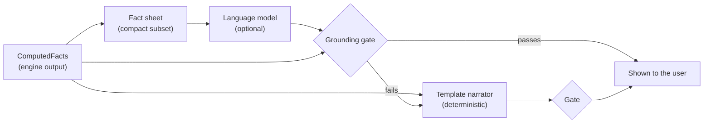

# Grounded language layer (submission artifact E)

> Code: [`greeniq/trust/`](../greeniq/trust/) · prompts: [`prompts.py`](../greeniq/trust/prompts.py) ·
> gate: [`gate.py`](../greeniq/trust/gate.py) · evaluation: [`reports/GROUNDING.md`](../reports/GROUNDING.md) ·
> tests: [`tests/test_trust.py`](../tests/test_trust.py)

## 1. The rule, and how it is enforced

PS2: *"Models calculate. The LLM explains."* In GreenIQ the language layer **cannot** produce a
number that reaches a user unless the engine computed it. That is enforced in code, not asked
for in a prompt:

1. **The engine computes** every score, kWh, tonne, £ and % (`analyse_home` → `ComputedFacts`).
2. **A template narrator** writes the explanation directly from those facts. Each sentence carries
   the fact paths it came from (shown in Evidence mode). This is the default and the fallback.
3. **Optionally, a language model** rewrites a compact *fact sheet* (`llm.fact_sheet`) into
   friendlier prose.
4. **The grounding gate** checks the model's text against the full facts. Anything that fails is
   **never shown**; the template explanation is shown instead, with the reason recorded.
5. **What-if questions** are parsed into a scenario by deterministic rules
   ([`assistant.py`](../greeniq/trust/assistant.py)), never by the model. The engine reruns first;
   only the new facts are explained.

The app is fully functional with no model at all.

## 2. Model and API details

| Item | Value |
|---|---|
| Default model | `claude-opus-5-5` (override with `GREENIQ_LLM_MODEL`) |
| SDK | official `anthropic` Python SDK, optional extra: `uv sync --extra llm` |
| Call | `client.beta.messages.create(model, max_tokens=2000, output_config={"effort": "low"}, betas=["server-side-fallback-2026-07-01"], fallbacks="default", system=SYSTEM_PROMPT, messages=[…])` |
| Effort | `low`: the task is rephrasing a short fact sheet, not reasoning |
| Refusal handling | server-side fallback (`fallbacks="default"`); a final `stop_reason == "refusal"` → template |
| Errors | connection, rate-limit and API-status errors → template (never raised to the user) |
| Activation | only when `ANTHROPIC_API_KEY` (or `ANTHROPIC_AUTH_TOKEN`) is set and the package is installed; `GREENIQ_LLM=off` forces the template |
| Cost | one call per explanation shown; nothing is called in tests or the default run |

The call shape was checked against Anthropic's current API reference.

## 3. Prompts (verbatim, version `explain-prompt/1.0`)

**System prompt** (`SYSTEM_PROMPT` in [`prompts.py`](../greeniq/trust/prompts.py)):

> You explain a home-energy analysis to a homeowner in plain British English. You are given FACTS as
> JSON, computed by GreenIQ's deterministic engines. They are the only source of truth. Your job is to
> explain them, not to add to them. Rules: use only numbers that appear in FACTS, copied exactly
> (kg may be shown as tonnes); never estimate, round differently, add or invent a number; if something
> isn't in FACTS, say it isn't known. Keep per-fuel directions exactly as given: a negative saving_kwh
> means use goes UP (a heat pump usually raises electricity while cutting gas). Savings from several
> measures do not simply add up. Property value is an indicative range from market patterns, never a
> promise and never caused by the work. Only talk about the measures in FACTS. 4 to 7 short sentences,
> no headings, bullets or markdown.

**User message:** `Explain this {home's analysis | retrofit package} to the homeowner. FACTS: {json}`,
where the JSON is `fact_sheet(facts, scope)`: score, band, status, the three biggest gaps, baseline
per fuel with its basis, confidence, the Next Best Action and its reasons, the package's per-fuel
baseline/after/saving, net saving, carbon, standalone sum and interaction, score and EPC band after,
cost range, value range with caveat, and any refused measures with reasons.

## 4. The grounding gate (`grounding-gate/1.1`)

Every explanation, template or model, passes these checks:

| Check | Blocks |
|---|---|
| **Numbers + units** | any number not in the facts (display rounding and kg↔t / kWh↔MWh tolerated); a number whose unit is the wrong kind (a "%" that is really kWh) |
| **Number role** (v1.1) | a *change* claim ("cuts gas by X", "saves X") that only matches a *level* fact (baseline or after-use). This closes the one miss in v1.0, where an inflated saving equalled the home's baseline use. |
| **Per-fuel direction** | "electricity falls" when the package raises it, and vice versa (the heat-pump trap) |
| **Value wording** | "guaranteed", "will increase your home's value", "proves", "will be worth" |
| **Scenario identity** | measures that are not in the package (or, for a whole-home explanation, not in the plan) |

## 5. Evaluation approach and results (ER-4)

`uv run python -m greeniq eval-grounding [--llm N]` runs on held-out **test-split** homes and writes
[`reports/GROUNDING.md`](../reports/GROUNDING.md):

1. **False blocks:** honest template explanations through the gate. Result: **0 of 387 blocked**, and
   3,952 of 3,952 numeric claims traced to facts.
2. **Catch rate:** each explanation is corrupted four ways and re-checked. Results:
   - invented number **187/187**;
   - flipped fuel direction **186/186**;
   - causal value promise **187/187**;
   - off-scenario measure **135/135**.
3. **Language-model output** (only with a key; never faked): grounded-claim share (target ≥ 90%),
   share of explanations passing the gate = factually accurate (target ≥ 90%), unsupported-claim
   share (target < 5%). **Not run in this build: no API key was available.** The report says
   "not run" rather than showing numbers. Whatever a model scores, users only ever see text that
   passed the gate, so delivered groundedness is 100% by construction.

In addition, `uv run python -m greeniq edge-sweep` checks that the home and package explanations of
**all 3,000 homes** pass the gate: 5,854 explanations, 0 failures
([`reports/EDGE_CASES.md`](../reports/EDGE_CASES.md)).

## 6. Limitations

- The gate checks what can be checked: numbers, units, roles, signs, scenario and value wording.
  A sentence can be number-correct yet misleading in tone; the prompt and the template are the
  defence there.
- Number matching tolerates display rounding only, so a model that rounds differently is blocked.
  That is by design: precision we did not compute is not shown.
- The what-if parser understands the catalogue's measures and simple phrasing ("only", "without",
  "already have"). Anything else gets an honest "I can answer what-ifs about these measures…".
