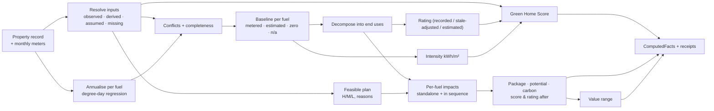

# GreenIQ methodology

> How every number is produced. Score mappings are in [SCORING_METHOD.md](SCORING_METHOD.md);
> data generation in [data/DATA_CARD.md](../data/DATA_CARD.md); models and evaluation in §7 and
> [`reports/EVALUATION.md`](../reports/EVALUATION.md). Code paths are given for every step.

## 1. Pipeline (`greeniq/pipeline.py::analyse_home`)

Every step is deterministic. Optional trained providers (baseline energy estimator, value
model, savings calibration) plug in through `EngineContext`; without them the result is
still complete and says which provider produced each number.

## 2. Annualising meter data (`greeniq/features/annualise.py`)

Degree-day regression per fuel (the PRISM method):

**kWh_m = a · days_m + b · HDD_m**, a, b ≥ 0, fitted on the valid months of the latest 12.
Annual = a·365 + b·HDD_normal-year. The two terms give **baseload** (hot water, cooking,
appliances) and **space heating**, weather-normalised.

| Status | Rule | Used as |
|---|---|---|
| metered_full | 12/12 months | metered baseline |
| metered_partial | ≥ 6 months incl. ≥ 2 cold (HDD ≥ 150) and ≥ 1 mild (HDD ≤ 80) | metered baseline (lower confidence) |
| insufficient | otherwise | model estimate, **labelled "estimated"** |
| zero | every valid read is 0 | baseline 0 → potential **unavailable**, intensity **not assessable** |
| no_data | no reads | model estimate, labelled |
| not_applicable | no gas connection | 0 by structure (not missing) |

**A missing month is never zero.** (Test: dropping 3 months moves the annual figure by under
2%; a zero-fill would have under-counted by over 5%.)

## 3. Per-fuel energy engine (`greeniq/engines/energy.py`, `physics.py`)

**Purchased energy** = grid electricity imported + gas, kWh/yr, both from the same
normal-year accounting.

### 3.1 Decomposition (anchored on the meters)
The baseline is split into useful space heat, useful hot-water heat, cooking gas and other
electricity, using the degree-day split and the heating system's efficiency (condensing
boiler 0.85 falling to 0.78 with age; non-condensing 0.72 → 0.62; resistance 1.0; heat pump
SCOP from heat loss per m², below). Underlying electricity **demand** = imports + estimated
solar self-consumption. The decomposition reproduces the metered baseline exactly (tested
to ±10 kWh).

### 3.2 Measures (applied in sequence to one evolving state)
| Measure | Physical change | Effect on energy |
|---|---|---|
| Loft insulation | loft → 270 mm | space heat × (1 − ΔHLC/HLC) |
| Cavity / solid wall | walls insulated (U 0.5 / 0.35) | space heat × (1 − ΔHLC/HLC) |
| Glazing | U → 1.6, infiltration −8% | space heat × (1 − ΔHLC/HLC) |
| Smart controls | — | space heat × (1 − 5%) (evidence range ≈ 0-10%; marked uncertain) |
| Air source heat pump | heating → heat pump, **SCOP fixed at installation** | gas space and water heating → electricity ÷ SCOP |
| Solar PV | 3-4 kWp by home type | imports − self-consumed generation (demand unchanged) |

HLC (heat loss coefficient) comes from an RdSAP-style model with published typical
U-values (`physics.py`). Applying the *fraction* ΔHLC/HLC to the **metered** heating keeps
savings anchored on how the household actually uses energy.

**Heat-pump efficiency:** SCOP = 3.4 − 0.8 × clip((HLC/m² − 1.2)/2.2, 0, 1), i.e. 2.6 in a
leaky home and 3.4 in a well-insulated one (Boiler Upgrade Scheme minimum 2.8; monitored UK
fleets often report more). Leaky homes need hotter flow temperatures, so they get less heat
per kWh. Because SCOP is fixed when the heat pump is installed, **insulating first gives a
better heat pump result than insulating after** (tested).

### 3.3 Interactions (why a package ≠ the sum of its parts)
- Fabric measures overlap: each removes a fraction of the *remaining* heat demand.
- A heat pump after insulation supplies less heat, at a higher SCOP.
- Solar is worth more after a heat pump: higher demand means more generation is self-consumed.

Each recommendation reports **standalone** (alone, from today's home) and **in package**
(marginal, in sequence). The package reports the sum of standalone savings and the
**interaction** = package − sum, explicitly.

### 3.4 Signs
Saving = baseline − after, per fuel. **A heat pump gives a negative electricity saving and a
positive gas saving.** Nothing is clipped or netted before display.

## 4. Retrofit planner (`greeniq/engines/retrofit.py`)

Feasibility first: only measures that can be installed in *this* home are recommended; every
other measure is listed with a status (`infeasible`, `not_needed`, `not_applicable`,
`needs_survey`, `declined`, `completed`) and a reason. Examples: no loft in a ground/mid-floor
flat; no cavity fill on solid walls; no heat pump without outdoor space; no panels on flats,
north-facing roofs or listed buildings.

**Suitability (H/M/L)** reflects evidence strength and expected benefit, e.g. loft High if
≤ 100 mm; heat pump High if heat loss after the recommended fabric is ≤ 2.0 W/K·m², Medium
≤ 2.8, otherwise Low ("insulate first"). Measures whose evidence is an age-band *assumption*
drop a level and say what a survey should confirm.

**Order:** stage (1 fabric → 2 controls → 3 heating → 4 solar), then suitability, then
standalone saving. This is the whole-house "fabric first" sequence used in UK retrofit
guidance.

**Costs:** indicative ranges from the catalogue (`greeniq/config/retrofit_catalogue.json`)
scaled by the home's loft, wall or window area, or kWp, with sources and price dates. Grant
information is shown as information, not eligibility advice.

## 5. Improvement potential and ranking (PS2 §04)

**Improvement potential = 100 × (E_baseline − E_after) / E_baseline**, E = imports + gas, with
E_after from the full feasible package. It is reported only when the baseline is **metered
and non-zero**. With a zero baseline it is `unavailable` (undefined). With an estimated
baseline it is `unavailable`, plus a separately labelled `indicative_pct` that is never used
for ranking.

## 6. Carbon (`greeniq/engines/carbon.py`, `greeniq/config/emission_factors.json`)

**ΔC = ΔE_elec × EF_elec + ΔE_gas × EF_gas.** DESNZ 2025 factors: electricity 0.177 and
gas 0.18296 kg CO₂e/kWh (sources, verification status and conventions are in the config).
Carbon is computed from the *displayed* (rounded) kWh savings, so anyone can reproduce it
from the screen. Positive = reduction, and a negative result is shown, not hidden.

## 6b. Rating (`greeniq/engines/rating.py`)

SAP-2012-style cost rating under standard occupancy and climate:
ECF = 0.42 × cost / (TFA + 45); SAP = 117 − 121·log₁₀(ECF) if ECF ≥ 3.5, else 100 − 13.95·ECF.
Used to (a) **estimate** a rating when no EPC exists, (b) **adjust a stale EPC** for work done
after it was lodged, and (c) estimate the **rating after** a package, as recorded SAP +
modelled change. Anchoring on the recorded rating cancels the model's own bias. This is not
an accredited SAP assessment.

## 6c. Data quality (`greeniq/features/quality.py`)

| Check | Example | Handling |
|---|---|---|
| Heating record vs meters | "heat pump" but 12,000 kWh/yr of seasonal gas | High-severity conflict; energy follows the meters; heating advice says "confirm first" |
| Gas boiler without gas use | no gas, electricity shows winter heating | Conflict; electric heating assumed for energy |
| Stale EPC | EPC 2019, solar installed 2025 | Rating adjusted by the modelled change, labelled "estimated" |
| Band vs SAP mismatch | SAP 70 recorded as D | SAP used |
| Implausible intensity | < 20 or > 700 kWh/m² | Flagged (check floor area) |

Each conflict lowers confidence (high/medium/low, additive and capped). Missing inputs
become ranked **questions for the customer** (e.g. "Do you have an EPC?").
